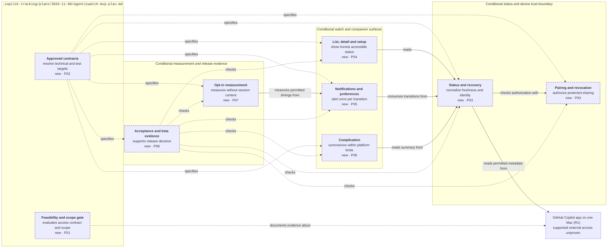

<!-- markdownlint-disable-file -->
# RPI Plan: AgenticWatch monitoring MVP

## Task Metadata

* Task ID: `AGENTICWATCH-MVP-PLAN-001`
* Task slug: `agenticwatch-mvp`
* Plan date: `2026-11-08`
* Primary planner: Picard; requested by Guy Bertental (`@guybartal`) through the coordinating parent.
* Source: [docs/prd/agenticwatch.md](../../../docs/prd/agenticwatch.md), `PRD-AGENTICWATCH-001`, draft `0.1.0`, handoff **Not ready**.
* Resolved plan path: `.copilot-tracking/plans/2026-11-08/agenticwatch-mvp-plan.md`.

## Executive Summary

**Planning revised with Guy's five decisions and the drafted GitHub request; product implementation Not ready.** Data's bounded public-source investigation ([research F1–F6](../../research/2026-11-08/agenticwatch-status-access-research.md)) found credible leads — desktop hooks, canvas extensions, experimental SDK live-peer listing and session events, and a cloud-only agent-tasks REST API — but no verified supported, read-only contract for existing Copilot desktop sessions. `ASM-001` is **unproven, not disproven**.

**Guy answered all five relayed decisions (2026-11-08).** `D9` = A: Guy sends the prepared GitHub request and product work stays gated until the reply is evaluated. `D2`/`Q-003`: R1 covers **one Mac**; multiple Macs stay R3. `D5`/`Q-004`: **open source**. `D3`/`Q-001`: "Finished responding" alerts **on by default** with opt-out. `D4`/`Q-002`: baseline measurement **deferred** until the access contract shows which timestamps exist, so `GOAL-001` stays unmeasurable until then. These answers are propagated to every affected task; the PRD file itself is not yet updated (follow-up).

**GitHub request: approved, ready for Guy to send.** Data drafted [the request](../../requests/2026-11-08/github-desktop-status-contract-request.md); Worf approved it with privacy changes; Picard rejected the first draft for three missing `P01-T01` asks (full state set, transition identity, update cadence/latency); Geordi revised it and Picard approved the revision on 2026-11-08. Guy sends next. Nothing has been sent. `P01-T01` stays unchecked until GitHub's reply is evaluated against the rubric.

The conditional MVP helps the user notice blocked sessions without returning to the Mac merely to check. Only after the access gate passes and an approved technical design exists should the team build secure pairing, reliable status, watch/companion views, notifications, complications, and privacy-preserving measurement. Platform/stack, delivery guarantees, whether the open-source release ships through the App Store/TestFlight (`D10`, deferred by Guy until GitHub's reply is evaluated against the request rubric), licensing, and precise implementation/test targets remain unresolved. Complexity labels are relative planning judgments, not schedules or approved assignments.

### What You May Not Know

* The tracked repository contains the draft PRD, Squad scaffolding, this plan and the access research, not a product implementation, technical design, BRD, ADR, or product test suite.
* Access to session status in this planning environment (for example agent-visible session tools) does not prove a supported external product integration.
* The cloud agent-tasks API is real and documented, but covers cloud agent tasks only; using it would be a **scope change** (cloud sessions are currently R3), not a way to satisfy the existing-desktop gate.
* SDK wait and idle events are ephemeral and are not replayed on resume; even a confirmed event route still needs a snapshot/resync contract for already-waiting sessions.
* No request has been sent to GitHub. The request is approved; sending it through a channel of his choice is Guy's action. Under `D9` = A there is no timebox: a silent or noncommittal reply leaves the gate blocked, and a no-go reply triggers a new scope decision rather than any fallback.
* Open source does not settle distribution mechanics. A watch app still needs a signed install path; whether the public release uses the App Store or TestFlight (making `CON-003` apply) or is source-only/self-built is `D10`, deferred by Guy until GitHub's reply is evaluated against the request rubric.
* Private-repository ruleset creation is separately blocked by a GitHub plan restriction (`403`, upgrade to Pro); this is not a prerequisite to beginning authorized feasibility investigation.
* "Finished responding" means a response ended, not task success. Complications cannot promise real-time updates; a connected-watch notification must independently meet the 30-second p95 requirement.
* Guy chose one Mac for R1, but the PRD's `DD-002` still says "Mac(s)" and `Q-001`–`Q-004` still read as open. The plan follows Guy's answers; updating [docs/prd/agenticwatch.md](../../../docs/prd/agenticwatch.md) is a follow-up for Picard/Guy, not done here.
* Deferring `Q-002` means `GOAL-001` (time-to-respond improvement) has no baseline method yet; no improvement claim is possible until the contract reveals usable timestamps and Guy picks a method.

## Phase Checklist

All tasks are **planned and unchecked**. Guy authorized the bounded `P01` public-source investigation; its evidence is saved and integrated into `P01-T01`, which remains incomplete because supported access has not been proven. `P01-T01` defines the GitHub contract request, now drafted in [the request file](../../requests/2026-11-08/github-desktop-status-contract-request.md) and approved to send, and its pass/fail evaluation. `P01-T02` records Guy's five answers and carries the remaining scope items (`D10` distribution channel, deferred by Guy until GitHub's reply is evaluated against the request rubric; `D8` sign-off owners). `P02` is gated design work. `P03`–`P08` are conditional outcomes, **not yet executable implementation instructions**. Exact files, stack-specific commands, runtime contracts, supported versions, and bounded test additions must be supplied in `P02` before implementation readiness.

### After

Intended logical boundaries only, conditional on `ASM-001` and `P02` approval. Boxes other than this plan are responsibility boundaries, not committed services, repository directories, deployment units, or transport choices. No Before diagram: tracked sources show no product implementation or established connection path to replace.

Key: arrows point from a part to what it uses; dotted arrows describe or verify; dashed border means new conditional responsibility; tags identify contributing phases.

Watch surfaces (`P04`–`P06`) consume status (`P03`), which checks pairing authorization and reads only a proven permitted source. Feasibility (`P01`) and design (`P02`) describe and constrain these responsibilities; measurement (`P07`) and acceptance/beta evidence (`P08`) verify outcomes without adding session content. The diagram does not establish external access or select a canvas extension, hook, SDK route, Mac agent, relay, cloud service, Apple framework, or delivery mechanism; candidate access routes stay inside the `P01` gate as evidence-labelled options.

<!-- rpi:phase id=P01 -->
### [ ] P01: Establish supported access and product scope

Goals:
* Establish whether the PRD is feasible without prohibited access, and make user-owned boundaries explicit before technical commitments.

Dependencies:
* None within the plan. Guy authorized and Data completed bounded supported-access research (F1–F6). Guy chose `D9` = A (send the request, keep product work gated). Sending the approved request, runtime verification and any later scope revision remain separate user-owned gates.

Changes in the map: adds the feasibility and scope gate.

<!-- rpi:task id=P01-T01 -->
#### [ ] P01-T01: Obtain and evaluate the supported external status contract

Goals:
* Produce a reproducible supported-access evidence record for `ASM-001`, or an explicit no-go or remaining-evidence result, by requesting a GitHub-supported contract and evaluating the response against fixed pass/fail criteria.

Requirements:
* `FR-002`, `FR-004`, `FR-005`, `FR-006`, `FR-007`, `FR-012`; `NFR-001`, `NFR-003`, `NFR-007`, `NFR-010`, `NFR-015`; `CON-001`, `CON-004`; `DD-003`, `DD-005`.
* Gate evidence must identify a documented permitted external mechanism, its support/terms basis, required permissions, real observable states and transitions, stable session identity, timestamps/freshness limits, attention categories, and missing fields — the four items of research F6.
* No internal scraping, reverse engineering, private endpoints, credential extraction, or content-bearing exports as substitutes. Inability to prove a permitted mechanism blocks shipping, not permission to bypass the constraint.

Details:
* Suggested assignee: Data drafted and evaluates the reply; Picard owns technical approval and the gate disposition; Worf reviews the permission/privacy asks and any response; Geordi revises the request after Picard's rejection (Data and Worf locked out for that cycle); Fact Checker verifies cited claims; **Guy chooses the channel and sends** (external communication on his behalf, `D9` = A). Complexity: **L**, because vendor response and cadence are unknown.
* **Evidence state (2026-11-08):** bounded public-source research complete ([F1–F6](../../research/2026-11-08/agenticwatch-status-access-research.md)). `ASM-001` is unproven, not disproven. Request drafted at [.copilot-tracking/requests/2026-11-08/github-desktop-status-contract-request.md](../../requests/2026-11-08/github-desktop-status-contract-request.md): Worf privacy review approved with changes (open-source/one-Mac context, consent and source-side content exclusion in item 5, explicit no-unsupported-internals statement); Picard rejected the first draft for three missing asks — full state set (item 3), transition identity and update cadence/latency (item 4) — plus rubric rows; Geordi's revision added them and Picard **approved** it on 2026-11-08 (ready for Guy to send). Not sent; no channel chosen; no runtime verification run; no route selected. This task stays unchecked until GitHub's reply is evaluated against the rubric.
* **Candidate routes (evidence-labelled options, none selected):**

  | Route | Evidence label | What is documented | Missing for this gate | Plan status |
  |---|---|---|---|---|
  | Desktop canvas extension | Partially supported (F2; W2, W11, W16) | Desktop canvas installation; per-session `joinSession`, `session.on`, runtime events | Passive attachment to every already-open session, chats/projects catalog, app names, read-only privilege, background lifecycle/revocation | In-scope candidate pending vendor contract |
  | Desktop hooks | Partially supported (F2; W3, W8) | Desktop supports repository/plugin hooks | Hook reference schema is CLI/cloud only; desktop event matrix, already-waiting snapshot, plan-wait parity | In-scope candidate pending vendor contract |
  | Experimental SDK `session.management.list` | Partially supported, experimental (F2; W20, W25) | Lists opted-in live local peers: `sessionId`, `name`, `cwd`, idle/busy | Off by default; desktop eligibility; no wait category, state-entry time, project name, all-session or replay guarantee | In-scope candidate pending vendor contract |
  | SDK session events (`user_input.requested`, `elicitation.requested`, `exit_plan_mode.requested`, `permission.requested`, `session.idle`) | Evidence-backed schema; desktop delivery unresolved (F3; W17, W23) | Event IDs, request/completion correlation, event-creation timestamps | Ephemeral, not replayed on resume; content-bearing payloads; desktop delivery and snapshot unproven | Possible signal source for any confirmed route |
  | Cloud agent tasks REST API | Evidence-backed for cloud tasks only (F4; W14, W15) | `GET /agents/tasks`, Agent tasks read permission, task/session states, public preview | Not local desktop sessions; `prompt` content in detail; no wait-category or state-entry time | Only via a new user-owned scope revision after a no-go (`D9` = A) |
  | Explicitly instrumented CLI/SDK sessions | Documented building blocks (F4 alternatives; W6, W10, W12) | SDK runtime/events, CLI customization | Changes monitored population and launch workflow | Only via a new user-owned scope revision after a no-go (`D9` = A) |
  | Private stores, ports, scraping, binary inspection, content exports | Rejected (`CON-004`) | — | — | Not attempted, not an option |

* **Request package for GitHub** (Data drafted; Worf reviewed; Picard approves technical content; Guy sends through a channel he chooses, for example GitHub Support, the public `github/copilot-sdk` issue tracker or GitHub Community — no channel is selected and nothing has been filed). The outgoing message must carry every item below; the [request file](../../requests/2026-11-08/github-desktop-status-contract-request.md) records the draft, review record and send record:
  1. *Applicability and support:* Is there a supported way for a locally installed third-party component to read status metadata for **all existing GitHub Copilot app sessions on macOS** (R1: one Mac, `D2`), including already-open and already-waiting sessions, chats and Projects? Which app/runtime versions, and is it stable or experimental? May an independent third party build and publicly distribute an **open-source** client that uses it (`D5`), and under what terms?
  2. *Route specifics:* Can a desktop canvas extension or hook observe sessions it was not launched in, and run while the user works elsewhere? Is `session.management.list` available to desktop sessions and under what opt-in? Which SDK events (`user_input.requested`, `elicitation.requested`, `exit_plan_mode.requested`, `permission.requested`, `session.idle`) are delivered for desktop sessions?
  3. *Minimal schema:* stable session identity and its mapping among app session, runtime session, Project and task IDs; session display name and **Project name**; current state distinguishing Working, waiting for a question/elicitation, waiting for plan approval, response ended, cancelled/error and unknown; **source state-entry timestamp** distinct from event or observation time.
  4. *Lifecycle:* current-state snapshot including already-pending waits; transition identity and ordering; missed-event replay or resync; heartbeat/freshness indicator; sleep, crash, restart and reconnect behaviour; expected publication cadence.
  5. *Permission and privacy:* read-only, least-privilege access that cannot answer, approve, prompt, start/resume work or change tool/permission registrations; consent, policy/admin controls and revocation; ability to obtain status without receiving prompts, responses, plan content, code or files.
* **Gate evaluation:**

  | Outcome | Evidence that qualifies | Plan effect |
  |---|---|---|
  | Pass (contract) | Official GitHub documentation, published API reference, or written response through an official GitHub channel covering request items 1–5 for named versions | Seek separate authorization for minimized runtime verification; when that reproduces the required states, check this task and unblock `P02-T01` for the confirmed route |
  | Partial | Official evidence covering some items, for example a supported extension route without state-entry timestamps or wait snapshots | Record a per-item gap list; route each gap to a user-owned PRD revision decision (for example duration measured from observation instead of state entry, per F5); task stays unchecked |
  | No-go | GitHub states no supported mechanism exists, or the only route needs private access, content export or write/control privileges | Record an explicit no-go result and check this task as a no-go record; under `D9` = A, Guy then makes a new scope decision (for example instrumented CLI/SDK sessions, cloud agent tasks, or pause), which requires a PRD revision and replanning; `P02` does not start for the original scope |
  | No response or unclear | No reply, or a reply without the requested commitments | Remains blocked; `D9` = A sets no timebox, and Guy may add a review checkpoint at any time; neither pass nor no-go is assumed |

  Never qualifying: observing the app UI, agent-visible tools such as `get_sessions_status`, generated declarations alone, community projects, a shared database path, or the app being built on the CLI.
* After a pass, the authorized verification distinguishes authoritative documentation from observations and reproduces Working, input wait, approval wait, finished-response transition, unknown values, disconnect, and recovery with minimized/redacted evidence.
* Record what is unavailable, including state-entry timestamps or response-time events; this record is the re-entry trigger for the deferred `Q-002` baseline decision (`D4`). Do not silently substitute poll-observation time for source-transition time or infer success from idle.
* If access is unsupported, Guy makes a new scope decision as the no-go row describes; do not implement an alternative secretly. A scope revision restarts this task against the revised target with new research rather than marking the original `ASM-001` passed.

References:
* [docs/prd/agenticwatch.md](../../../docs/prd/agenticwatch.md): `PRD-AGENTICWATCH-001` draft, `ASM-001`, `ASM-002`, `DD-003`, `DD-005`, `CON-001`, `CON-004`, relevant FR/NFR above.
* [.copilot-tracking/research/2026-11-08/agenticwatch-status-access-research.md](../../research/2026-11-08/agenticwatch-status-access-research.md): F1–F6, candidate-route table, evidence W1–W25, research decision D4 (superseded by plan `D9`).
* [.copilot-tracking/requests/2026-11-08/github-desktop-status-contract-request.md](../../requests/2026-11-08/github-desktop-status-contract-request.md): outgoing message, internal evaluation rubric, Worf and Picard review records, send record.
* [.squad/agents/picard/charter.md](../../../.squad/agents/picard/charter.md): validate access with Data before design.

Dependencies:
* Research complete; `D9` = A. Request approved (Picard, 2026-11-08); sending is Guy's action. Gate evaluation depends on GitHub's reply. Runtime verification needs separate authorization after a pass.

<!-- rpi:task id=P01-T02 -->
#### [ ] P01-T02: Resolve user-owned scope and measurement decisions

Goals:
* Establish an approved R1 boundary: Guy's answers to `D9` and `Q-001`–`Q-004` are recorded and propagated, `D10` (distribution channel) is decided after its deferral trigger, and `D8` sign-off owners are resolved, before `P02-T01` approval.

Requirements:
* `FR-007`, `FR-008`, `FR-011`, `FR-013`; `NFR-007`, `NFR-009`, `NFR-011`, `NFR-014`, `NFR-016`; `CON-003`, `CON-004`; `DD-001`, `DD-002`, `DD-004`, `DD-005`.
* Answers recorded in [Confirmed User Direction](#confirmed-user-direction): `D9` = A; `Q-003` one Mac in R1 (multi-Mac remains R3); `Q-004` open source; `Q-001` Finished alerts on by default with opt-out; `Q-002` deferred until the access contract shows which timestamps exist.
* `D10` (does the open-source release use the App Store/TestFlight, so `CON-003` applies, or source-only/self-build?) is **deferred by Guy's choice** (2026-11-08) until GitHub's reply is evaluated against the request rubric; it is not an open question awaiting relay. Remaining open: `D8` sign-off owners. The deferred `Q-002` baseline method is decided after the `P01-T01` outcome and gates `P02-T02` measurement contracts and `P07-T01`, not this task.

Details:
* Suggested assignee: Picard, with Guy as decision owner; Troi advises notification/setup trade-offs; Worf advises measurement/privacy; Geordi advises on `D10` install/signing feasibility. Complexity: **S** remaining.
* All five relayed decisions were answered verbatim by Guy through the coordinating parent on 2026-11-08; their question blocks are removed. `D10` is a sub-question that the open-source answer exposed; Guy chose to decide it later, after GitHub's reply (see [Confirmed User Direction](#confirmed-user-direction)). The plan does not assume a channel.
* The PRD still lists `Q-001`–`Q-004` as open and `DD-002` says "Mac(s)". The plan does not edit the PRD; updating it is a follow-up for Picard/Guy (see [Follow-Up Items](#follow-up-items)).
* Record owner/reviewer sign-off responsibilities currently TBD in the PRD. Open-source public distribution makes the PRD's legal/compliance approval required. No PRD editing or approval is implied by this plan.

References:
* [docs/prd/agenticwatch.md](../../../docs/prd/agenticwatch.md): `PRD-AGENTICWATCH-001` draft, `Q-001`–`Q-004`, `DD-002`, `CON-003`, R1/R3 framing, sign-off, `GOAL-001`–`GOAL-003`, identifiers above.
* [.copilot-tracking/research/2026-11-08/agenticwatch-status-access-research.md](../../research/2026-11-08/agenticwatch-status-access-research.md): F5 timing and distribution-terms limits relevant to `Q-002` and `Q-004`.
* [.squad/team.md](../../../.squad/team.md): roles and personal monitoring boundary.

Dependencies:
* `D10`: deferral trigger — GitHub's reply is evaluated against the request rubric (`P01-T01`). None for `D8`. The deferred `Q-002` method depends on the `P01-T01` outcome.

<!-- rpi:phase id=P02 -->
### [ ] P02: Approve technical design and verification contracts

Goals:
* Translate proven capabilities and resolved product scope into approved, implementable contracts and a bounded evidence strategy.

Dependencies:
* `P01-T01` complete with a **pass** outcome for the original scope (or for a user-approved revised scope after replanning), and `P01-T02` complete (`D10` decided after its deferral trigger, `D8`). A no-go record does not unblock `P02`. The deferred `Q-002` baseline method additionally gates `P02-T02` measurement contracts.

Changes in the map: adds approved contracts governing every conditional responsibility.

<!-- rpi:task id=P02-T01 -->
#### [ ] P02-T01: Define and approve the monitoring technical design

Goals:
* Establish concrete component boundaries, platform support, and contracts that satisfy the PRD without architecture-by-assumption.

Requirements:
* `FR-001`, `FR-002`, `FR-004`, `FR-005`, `FR-006`, `FR-007`, `FR-009`, `FR-010`, `FR-011`, `FR-012`, `FR-013`; `NFR-001`–`NFR-010`, `NFR-014`–`NFR-016`; `CON-001`–`CON-004`; `DD-001`–`DD-005`.
* Resolve identity and transition identity, timestamp provenance/clock handling, ordering/replay, freshness, reconnect reconciliation, revocation in-flight semantics, encrypted transport/storage, notification routing and lock disclosure, retention, and complication update limits.
* Account for source-to-watch latency under platform restrictions; no unsupported guarantee and no content collection to fill metadata gaps.

Details:
* Suggested assignee: Picard; Data and Geordi contribute integration/platform evidence, Troi surface contracts, Worf security review. Complexity: **L**.
* Select stack, supported macOS/iOS/watchOS versions, topology, delivery mechanism, and precise implementation paths only after the gate. Any operational metadata beyond the PRD's five fields needs a justified minimum, privacy review, and user approval where scope changes; timestamps/identifiers must not become a content loophole.
* **Route-conditional inputs.** The design is written for whichever route `P01-T01` confirms; none is preselected. Each confirmed route carries design questions from the research:
  * Desktop canvas extension or hooks: the in-app component's lifecycle, startup and revocation; a local metadata-only projection that drops prompts, plan content, answers and tool output before anything leaves the Mac (F3, F5); desktop event matrix and already-waiting snapshot.
  * SDK peer listing or session events: opt-in activation and eligibility boundary; mapping busy/idle plus wait events to the four labels without inferring success from `session.idle`; resync for ephemeral events not replayed on resume (F3).
  * Cloud agent tasks or instrumented CLI/SDK sessions: only after a no-go and a new user-owned scope revision with replanning (`D9` = A); cloud detail responses include `prompt` and require filtering, user-token auth and preview-version handling (F4).
  * Any route lacking source state-entry timestamps uses only the duration semantics the user approved through the `P01-T01` partial-outcome decision.
* Specify attention summaries as categories such as Question or Plan approval, not question text. Specify unknown-state fallback and freshness semantics for every surface, including retained disconnected snapshots.
* Resolve deduplication across retries/restarts/reconnects, consent/preference propagation, pairing ownership, secure persistence, and immediate stop-sharing behavior for **one Mac source** (`D2`). Session and transition identity need only be unique within that Mac; define what happens when the user connects a different Mac (for example, whether it replaces the existing pairing) without designing multi-Mac aggregation, which stays R3.
* Notification preferences default Finished-responding alerts **on** with opt-out (`D3`); Needs-you behaviour is unchanged.
* Distribution design follows `D5` open source: the repository layout, build reproducibility and signing approach must let others build and run it without project-held secrets; App Store/TestFlight-specific obligations apply only if `D10` selects that channel; `D10` is deferred by Guy until GitHub's reply is evaluated against the request rubric and must be decided before this design is approved.
* Approval evidence must identify Guy/product sign-off, Picard technical acceptance, Worf quality/security review, Geordi platform feasibility, and required team consensus. Open-source public distribution requires the PRD's legal/compliance approval, including the third-party terms GitHub states in reply to request item 1. Do not invent a prior ADR or approved design.

References:
* [docs/prd/agenticwatch.md](../../../docs/prd/agenticwatch.md): `PRD-AGENTICWATCH-001` draft, technical design deferred, referenced FR/NFR/CON/DD and sign-off.
* [.copilot-tracking/research/2026-11-08/agenticwatch-status-access-research.md](../../research/2026-11-08/agenticwatch-status-access-research.md): F2–F5 route limits, timing and privacy constraints.
* [.squad/decisions.md](../../../.squad/decisions.md): no active decisions; meaningful changes require team consensus.
* [.squad/routing.md](../../../.squad/routing.md): architecture/integration/platform/security ownership.

Dependencies:
* `P01-T01` pass outcome naming the confirmed route; `P01-T02` (`D10` decided after its deferral trigger — GitHub's reply is evaluated against the request rubric — and `D8`).

<!-- rpi:task id=P02-T02 -->
#### [ ] P02-T02: Lock requirement fixtures, test targets, and evidence rules

Goals:
* Establish stack-specific tests and measurement definitions that can distinguish semantic correctness, regressions, and real device delivery before product work starts.

Requirements:
* `FR-001`–`FR-013`, `AC-001`–`AC-013`, `NFR-001`–`NFR-016`; `CON-002`, `CON-004`; `DD-003`.
* Test owner is **Worf**. Exact removals: **none**. Existing suite/test count: **not established**; no count or baseline pass is claimed.
* Maximum test additions and exact canonical/generated targets must be set and approved by Worf after stack selection, before readiness/critique. They are **unresolved now**, not an unlimited allowance or fabricated count.

Details:
* Suggested assignee: Worf; Data supplies supported-state fixtures derived from the confirmed route's contract (synthetic or redacted, since SDK/hook/task payloads can carry content), Geordi device/platform harnesses, Troi accessibility cases. Complexity: **M**.
* Semantic coverage: all four labels, wait categories, source vs observation clocks, transition identity, stale boundary, unknown values, ordering, consent, security, and negative cases. Regression coverage: once implementation exists, preserve working pairing, cache/persistence, reconnect, preferences, and alert history across approved version changes; do not mistake greenfield fixtures for proof of prior behavior.
* Canonical targets are approved source tests/fixtures; generated outputs derive from them and must not be hand-edited. There are no established product targets to name today. Select the smallest relevant existing runner once one exists; expand only when findings justify it.
* Define connected-watch conditions, supported-device/OS matrix (one Mac source per `D2`), source-transition and watch-receipt evidence, synchronized clocks/uncertainty, sample size and reporting method for p95. A queued/sent event, iPhone receipt, simulator success, or mocked haptic does not prove Apple Watch delivery.
* Notification fixtures cover the Finished-responding default-on state (`AC-007` with no user change) and opt-out (`AC-008`), per `D3`.
* **Baseline measurement is deferred (`D4`/`Q-002`).** Do not define the `GOAL-001` baseline method until `P01-T01` shows which source timestamps exist and Guy chooses a method; until then `GOAL-001` is unmeasurable and this task can lock only the non-baseline latency and correctness contracts.
* Include real devices, locked/unlocked watch, permission denied, unreachable devices, source update cadence, sleep/wake and background restrictions. If delivery receipt evidence cannot be obtained via supported mechanisms, retain a verification blocker or seek an approved measurement revision.
* Worf defines synthetic/redacted data, security assertions, accessibility evidence, measured setup/list timing, and reproducible acceptance records. No tests, harness, or dependency installs run in this planning assignment.

References:
* [docs/prd/agenticwatch.md](../../../docs/prd/agenticwatch.md): `PRD-AGENTICWATCH-001` draft, full FR/AC/NFR catalogs and success metrics.
* [.squad/routing.md](../../../.squad/routing.md): Worf owns testing, duplicate-alert, latency, stale/recovery, and security evidence.

Dependencies:
* `P02-T01` approved design; the deferred `Q-002` baseline method for measurement contracts; then planner revises exact implementation tasks and runs standard critique only when otherwise implementation-ready.

<!-- rpi:phase id=P03 -->
### [ ] P03: Establish secure sharing and trustworthy status

Goals:
* Permit only explicitly paired devices to receive minimized data, and recover honest status without leaking content or presenting stale information as live.

Dependencies:
* `P02-T01`, `P02-T02`, required approvals, revised executable plan, and standard critique with blocking findings resolved.

Changes in the map: adds pairing and revocation, status and recovery.

<!-- rpi:task id=P03-T01 -->
#### [ ] P03-T01: Implement pairing, protected persistence, and revocation

Goals:
* Only explicitly paired personal devices receive protected status; disconnect/revoke stops future sharing and alerts from the Mac.

Requirements:
* `FR-011`, `FR-013`, `AC-011`, `AC-013`; `NFR-005`, `NFR-006`, `NFR-007`, `NFR-015`, `NFR-016`; `DD-001`, `DD-002`; `CON-004`.
* Revocation must satisfy no further status or notifications reaching the watch, including queued/in-flight paths as defined by approved design; do not weaken `AC-013` to a UI-only disconnect.

Details:
* Suggested assignee: Geordi, with Data on source boundary and Worf security/test ownership. Complexity: **L**.
* Implement the approved trust lifecycle, least permissions, approved protected storage/transport and removal of access on revoked devices. R1 pairs **one Mac** with the user's watch/iPhone (`D2`): one source to pair, revoke and verify; multi-Mac pairing is R3. No new credential system or cryptographic primitive is assumed here.
* Worf tests unpaired/revoked-device denial, expired/replayed pairing attempts, ownership isolation, persisted protection, minimal data, and revocation during offline/retry/queued delivery conditions. UI setup consumes this capability in `P04-T01`.

References:
* [docs/prd/agenticwatch.md](../../../docs/prd/agenticwatch.md): `PRD-AGENTICWATCH-001` draft, cited pairing/revoke and privacy/security identifiers.
* [.squad/routing.md](../../../.squad/routing.md): Geordi/Data engineering and Worf security ownership.

Dependencies:
* `P02-T01`, `P02-T02`, plan readiness gate described in `P03`.

<!-- rpi:task id=P03-T02 -->
#### [ ] P03-T02: Implement normalized status, freshness, and automatic recovery

Goals:
* Consumers receive one honest state per session, its duration and freshness, and automatically reconciled attention state after temporary loss.

Requirements:
* `FR-002`, `FR-004`, `FR-005`, `FR-012`, `AC-002`, `AC-004`, `AC-005`, `AC-012`; `NFR-003`, `NFR-004`, `NFR-007`, `NFR-009`, `NFR-010`, `NFR-015`; `CON-001`, `CON-004`; `DD-003`.
* Current status is never older than 2 minutes; elapsed time **greater than 2 minutes** is visibly stale or Unknown/Offline. Unknown source values degrade to Unknown, never optimistic Working or Finished responding.
* Temporary loss recovers status and pending attention states without user action; new transitions remain distinct from replayed snapshots.

Details:
* Suggested assignee: Data; Geordi integrates the approved device delivery boundary; Worf owns tests. Complexity: **L**.
* Consume only the proven supported access mechanism on the single paired Mac (`D2`). Enforce minimum payload, approved stable identity, state-entry time and last-refresh provenance; source success is not inferred from idle.
* Worf exercises boundary timestamps at/below/above 2 minutes, clock changes, reordered/duplicate updates, missing sessions, unknown schema/state, Mac/device/source loss and sleep/wake, and at least 25 concurrent sessions. Recovery cannot silently refresh an old snapshot timestamp to make it current.
* Establish transition semantics consumed by `P05`; any missing source capability returns to design instead of an unsupported workaround.

References:
* [docs/prd/agenticwatch.md](../../../docs/prd/agenticwatch.md): `PRD-AGENTICWATCH-001` draft, status/freshness/recovery identifiers above, `ASM-002`.
* [.squad/team.md](../../../.squad/team.md): honest labels and minimal-data context.

Dependencies:
* `P03-T01`; `P02-T01`, `P02-T02` and `P03` readiness gate.

<!-- rpi:phase id=P04 -->
### [ ] P04: Deliver guided companion setup and accessible watch views

Goals:
* A user can connect without configuration files and read trustworthy, attention-first session information quickly on Apple Watch.

Dependencies:
* `P03-T01`, `P03-T02`.

Changes in the map: adds list, detail and setup.

<!-- rpi:task id=P04-T01 -->
#### [ ] P04-T01: Implement companion setup, connection controls, and guidance

Goals:
* The iPhone companion guides setup and disconnect, and explains permissions or connectivity failures without exposing session content.

Requirements:
* `FR-011`, `FR-012`, `FR-013`, `AC-011`, `AC-012`, `AC-013`; `NFR-005`, `NFR-006`, `NFR-007`, `NFR-012`, `NFR-013`, `NFR-014`, `NFR-015`, `NFR-016`; `DD-001`, `DD-002`.
* A new user completes guided setup in **under 3 minutes**, without editing manual configuration files; all screens support VoiceOver/Dynamic Type.

Details:
* Suggested assignee: Geordi; Troi owns setup/accessibility design, Worf tests. Complexity: **M**, provisional on approved pairing design.
* R1 connects exactly one Mac (`D2`); no multi-Mac onboarding (R3). Use the `P02-T01` behavior for connecting a different Mac. Make disconnected/denied/revoked states understandable and ensure controls act on the trust lifecycle.
* Worf measures new-user setup on supported real devices and verifies permission-denied, retry, revoke, accessibility and minimal disclosure flows.

References:
* [docs/prd/agenticwatch.md](../../../docs/prd/agenticwatch.md): `PRD-AGENTICWATCH-001` draft, cited setup/connection identifiers, `ASM-004`.
* [.squad/routing.md](../../../.squad/routing.md): Geordi companion and Troi setup ownership.

Dependencies:
* `P03-T01`, `P03-T02`.

<!-- rpi:task id=P04-T02 -->
#### [ ] P04-T02: Implement watch list, detail, and freshness presentation

Goals:
* Users see active sessions ordered by attention and inspect state duration and safe attention category, with readable accessible freshness.

Requirements:
* `FR-001`–`FR-005`, `FR-012`, `AC-001`–`AC-005`, `AC-012`; `NFR-002`, `NFR-003`, `NFR-007`, `NFR-009`, `NFR-012`, `NFR-013`, `NFR-016`; `DD-003`.
* List opens and is readable in **at most 2 seconds**; supports **at least 25 concurrent sessions** without degrading readability or notification timeliness.
* Order is Needs you, Working, Finished responding, Unknown/Offline; exactly one honest label per session, icons/text beyond color, and last-updated time in every status view.

Details:
* Suggested assignee: Geordi; Troi owns UX/accessibility, Worf tests. Complexity: **L**.
* Worf covers `AC-001` with three active sessions, mixed ordering, plan-approval detail, large session counts, long names, Dynamic Type, VoiceOver, stale/offline presentation, and measured readability on devices. Do not render actual question text.
* Use approved freshness/cached-state contract; displaying cached information must not imply currentness. Mock UI timing is preliminary, not final device evidence.

References:
* [docs/prd/agenticwatch.md](../../../docs/prd/agenticwatch.md): `PRD-AGENTICWATCH-001` draft, referenced watch-view FR/AC/NFR and honest-state glossary.
* [.squad/routing.md](../../../.squad/routing.md): Geordi watch/Troi accessibility/Worf acceptance ownership.

Dependencies:
* `P03-T02`, `P04-T01` for integrated paired-user evidence.

<!-- rpi:phase id=P05 -->
### [ ] P05: Deliver timely, private, nonduplicating notifications

Goals:
* State transitions notify according to approved preferences, with trustworthy watch delivery and bounded disclosure/replay.

Dependencies:
* `P03-T02`, `P04-T01`, `P04-T02`.

Changes in the map: adds notifications and preferences.

<!-- rpi:task id=P05-T01 -->
#### [ ] P05-T01: Implement watch notifications and preference controls

Goals:
* Needs-you and enabled Finished-responding alerts follow per-type/per-session preferences, without prohibited locked-watch disclosure.

Requirements:
* `FR-006`, `FR-007`, `FR-008`, `AC-006`, `AC-007`, `AC-008`; `NFR-001`, `NFR-007`, `NFR-008`, `NFR-009`, `NFR-012`, `NFR-013`; `CON-002`; `DD-003`, `DD-004`.
* Connected-watch Needs-you events arrive within **30 seconds for at least 95% of events (p95 ≤30 seconds)**. With 25 or more concurrent sessions, required notification timeliness still holds.
* Locked-watch notifications reveal **no more than session name and state**; attention type is available only where disclosure is allowed. Notifications never include project/attention text on locked watch or any prompts/responses/code/files anywhere.
* Finished notification triggers on Working → Finished responding when enabled. Per `D3`/`Q-001`, Finished-responding alerts are **on by default** for all sessions, and the user can turn them off per type or limit them to selected sessions (`FR-008`); `AC-007` holds in the default state, and `AC-008` holds after opt-out.

Details:
* Suggested assignee: Geordi; Troi preferences/copy, Data transition integration, Worf delivery/privacy tests. Complexity: **L**.
* Apply settings to future notifications; cover each type on/off and all/selected-session choices, starting from the default-on Finished setting. Needs-you alerts include haptic, name and attention category under permitted unlocked presentation. Copy must make clear that "Finished responding" means a response ended, not task success, since default-on alerts reach every user.
* Worf verifies actual supported-watch receipt/haptics and locked/unlocked payload rendering, denied permissions, app foreground/background, and supported routing conditions. Measure full source-transition-to-watch latency, not send-to-provider latency.

References:
* [docs/prd/agenticwatch.md](../../../docs/prd/agenticwatch.md): `PRD-AGENTICWATCH-001` draft, notifications and disclosure identifiers, `Q-001` (answered: on by default), `CON-002`.
* [.squad/routing.md](../../../.squad/routing.md): platform notification and quality ownership.

Dependencies:
* `P03-T02`, `P04-T01`, `P04-T02` and `P02` delivery contract.

<!-- rpi:task id=P05-T02 -->
#### [ ] P05-T02: Implement persistent deduplication and recovered attention

Goals:
* Replayed/retried updates cannot duplicate alerts, while genuinely new transitions and pending attention recover correctly.

Requirements:
* `FR-006`, `FR-007`, `FR-008`, `FR-009`, `FR-012`, `FR-013`, `AC-006`–`AC-009`, `AC-012`, `AC-013`; `NFR-001`, `NFR-003`, `NFR-004`, `NFR-005`, `NFR-009`.
* **At most one notification per state change per session**; exactly one for the enabled eligible single-transition `AC-009` scenario, and zero when disabled, unselected, or revoked.
* Automatic reconnect restores status/pending attention without user action, duplicate alerts, fabricated new transitions, or revoked-Mac sharing.

Details:
* Suggested assignee: Data and Geordi (Data primary for transition identity); Worf test owner. Complexity: **L**.
* Implement the approved transition ledger/identity contract, not dedupe solely by display name or current state. Separate recurring real Needs-you transitions from duplicate transport deliveries.
* Worf exercises retries, restart/persistence, out-of-order replay, repeated same-state snapshots, disconnect/reconnect, preference changes, queued delivery/revoke races, and the single-Mac source (`D2`). Reconcile offline pending notifications with design's expiry/freshness rules; offline events do not prove connected-watch p95.

References:
* [docs/prd/agenticwatch.md](../../../docs/prd/agenticwatch.md): `PRD-AGENTICWATCH-001` draft, dedupe/recovery/revoke and latency identifiers.
* [.squad/routing.md](../../../.squad/routing.md): Worf duplicate alerts and recovery ownership.

Dependencies:
* `P05-T01`, `P03-T01`, `P03-T02`.

<!-- rpi:phase id=P06 -->
### [ ] P06: Add trustworthy complication summaries

Goals:
* Users can glance at attention count and working presence without mistaking platform-limited refresh for real-time status.

Dependencies:
* `P04-T02`, `P05-T02`.

Changes in the map: adds the complication.

<!-- rpi:task id=P06-T01 -->
#### [ ] P06-T01: Implement accessible, freshness-aware complications

Goals:
* Complications summarize needs-you count and any Working sessions within approved platform refresh limits.

Requirements:
* `FR-010`, `FR-002`, `FR-005`, `FR-012`, `AC-010`, `AC-002`, `AC-005`, `AC-012`; `NFR-003`, `NFR-007`, `NFR-012`, `NFR-013`, `NFR-016`; `CON-002`; `DD-003`, `DD-004`.
* `AC-010` shows a count of 2 for two needs-you sessions within platform update limits; stale data cannot be presented as current.

Details:
* Suggested assignee: Geordi; Troi glance/accessibility design, Worf tests. Complexity: **M**.
* Approved design must reconcile platform scheduling with stale display; cached complication snapshots need an honest stale/unknown representation after 2 minutes. No real-time promise or weakening of `NFR-003`.
* Worf validates count/working summary, no-color-only distinction, privacy and actual supported-watch refresh behavior. Notifications remain the time-critical surface, not complication refresh.

References:
* [docs/prd/agenticwatch.md](../../../docs/prd/agenticwatch.md): `PRD-AGENTICWATCH-001` draft, complication, freshness, accessibility identifiers and `CON-002`.
* [.squad/routing.md](../../../.squad/routing.md): Geordi complication and Troi glance design ownership.

Dependencies:
* `P04-T02`, `P05-T02`, approved `P02` complication/freshness contract.

<!-- rpi:phase id=P07 -->
### [ ] P07: Establish opt-in privacy-preserving measurement

Goals:
* Measure timely alerts and reduced waiting using approved consent/baseline methods, without collecting content.

Dependencies:
* `P05-T02`; the deferred `Q-002` baseline method (decided by Guy after `P01-T01` shows which timestamps exist) and approved `P02` measurement contract.

Changes in the map: adds opt-in measurement.

<!-- rpi:task id=P07-T01 -->
#### [ ] P07-T01: Implement consented latency and response-time measurement

Goals:
* Opt-in telemetry can measure notification delivery latency and time to user response without session content or unauthorized observation.

Requirements:
* `NFR-001`, `NFR-006`, `NFR-007`, `NFR-008`, `NFR-011`; `CON-001`, `CON-004`; `GOAL-001`, `GOAL-003`.
* Opt-in only; no prompts/responses/code/files in telemetry, logs, fixtures, diagnostics or watch payloads. Timing instrumentation must not collect content-bearing exports.

Details:
* Suggested assignee: Data; Geordi supplies approved watch delivery measurement, Worf privacy/test ownership, Picard metric contract. Complexity: **M**, conditional on supported response-event access.
* Implement approved consent, minimized correlation data, retention/deletion and the baseline method Guy chooses after the deferral (`D4`). Session/project names are not automatically required for telemetry merely because watch payloads permit them.
* Worf verifies opt-out/no emission, withdrawn consent, data minimization, clock uncertainty, latency definition, and evidence of real user response via supported metadata or approved user-reported method. If a valid response timestamp or delivery evidence is unavailable, retain a metric blocker rather than relabel source observation as truth.
* Compare the PRD's median Needs-you-to-response improvement with the approved baseline; do not claim causality or target attainment from a simulator. Until the deferred baseline method exists, `GOAL-001` is unmeasurable and no improvement may be reported.

References:
* [docs/prd/agenticwatch.md](../../../docs/prd/agenticwatch.md): `PRD-AGENTICWATCH-001` draft, `NFR-011`, `Q-002` (deferred by Guy), `GOAL-001`, success-metric definitions.
* [.squad/routing.md](../../../.squad/routing.md): Data integration and Worf privacy/quality responsibilities.

Dependencies:
* `P05-T02`, `P02-T02`, deferred `Q-002` baseline method chosen after the `P01-T01` outcome.

<!-- rpi:phase id=P08 -->
### [ ] P08: Verify acceptance and decide beta/distribution readiness

Goals:
* Establish reproducible product/security/device evidence and a user-approved release path, without representing planned tests or beta targets as passed.

Dependencies:
* `P04`–`P07` complete; `P03` security/recovery evidence available.

Changes in the map: adds acceptance and beta evidence.

<!-- rpi:task id=P08-T01 -->
#### [ ] P08-T01: Verify all acceptance and quality thresholds

Goals:
* Produce Worf-owned evidence for the entire FR/AC/NFR boundary on the approved platform/device matrix.

Requirements:
* `FR-001`–`FR-013`, `AC-001`–`AC-013`, `NFR-001`–`NFR-016`, `CON-001`–`CON-004`, `DD-001`–`DD-005`.
* Required measured thresholds: connected-watch Needs-you **p95 ≤30 seconds**, readable list **≤2 seconds**, stale **>2 minutes**, **≥25 concurrent sessions**, setup **<3 minutes**, at most one alert per transition, and zero alerts/sharing after revoke or for disabled preferences.
* Required behavior: automatic status/pending-attention recovery, unknown-value degradation, explicitly paired-only protected data, locked-watch name/state-only disclosure, minimal payload, VoiceOver/Dynamic Type, and approved macOS/Apple Watch/iPhone compatibility.

Details:
* Suggested assignee: **Worf**; Geordi real-device evidence, Data supported-source traces, Troi accessibility/readability assessment, Picard readiness reconciliation. Complexity: **L**.
* Execute the locked `P02-T02` suite, not invented commands. Keep semantic assertions separate from regression checks and source/device/notification delivery measurements. No removals; preserve canonical tests and generate derived targets as approved.
* Verify all 13 AC with reproducible scenarios, plus NFR coverage AC alone does not provide. Include security negative cases, replay/race recovery, 25-session load, locked-watch delivery, permissions/background restrictions and stale complication behavior.
* Record actual runner/environment/sample sizes and failures; unsupported devices or unobservable delivery remain limitations/blockers. Mock/source-only/simulator results cannot pass physical-watch latency/haptic/disclosure gates.

References:
* [docs/prd/agenticwatch.md](../../../docs/prd/agenticwatch.md): `PRD-AGENTICWATCH-001` draft, complete FR/AC/NFR catalog; all AC currently Not Started.
* [.squad/routing.md](../../../.squad/routing.md): Worf owns testing/security and Picard/Worf review.

Dependencies:
* `P03-T01`, `P03-T02`, `P04-T01`, `P04-T02`, `P05-T01`, `P05-T02`, `P06-T01`, `P07-T01`, locked `P02-T02` targets.

<!-- rpi:task id=P08-T02 -->
#### [ ] P08-T02: Evaluate beta outcomes and approved distribution

Goals:
* Give Guy an evidence-backed release/support decision within personal R1 scope and approved distribution constraints.

Requirements:
* `FR-001`–`FR-013`; `NFR-001`, `NFR-009`, `NFR-011`, `NFR-014`, `NFR-015`, `NFR-016`; `CON-003`; `DD-001`, `DD-002`; `GOAL-001`–`GOAL-003`.
* Preserve PRD targets: median time-to-respond improves **≥50% versus approved baseline within 4 weeks** (unmeasurable until the deferred `Q-002` baseline method exists; report as not measured rather than estimate); **≥70%** report fewer checking trips after **2 weeks**; **≥90%** rate Needs-you/Finished-responding notifications accurate and timely in beta. Weekly active use target **≥60% of installers over 4 weeks** remains a metric, not fabricated evidence.

Details:
* Suggested assignee: Picard; Troi beta feedback, Worf quality/sign-off, Geordi distribution feasibility. Complexity: **M**; no launch date or cohort size is claimed.
* Beta protocol, cohort/sample adequacy and the PRD's deferred SMART evaluation need approved definitions before enrollment. Personal-use scope is not permission to expand into team/shared monitoring.
* Apply Guy's `Q-004` answer (**open source**, `D5`): public source repository with an approved license, contribution and security-disclosure policies, and the PRD's legal/compliance approval including GitHub's third-party terms from `P01-T01` item 1. Whether binaries also ship through the App Store/TestFlight — which brings `CON-003` App Review obligations — is `D10`, deferred by Guy until GitHub's reply is evaluated against the request rubric; if the release is source-only, document the self-build/signing path. Open source alone does not prove install/distribution viability.
* Publish actual limitations and gate results for Guy's release decision. Goal windows are measurement windows after adoption, not promised delivery dates.

References:
* [docs/prd/agenticwatch.md](../../../docs/prd/agenticwatch.md): `PRD-AGENTICWATCH-001` draft, success metrics, `Q-002` (deferred), `Q-004` (answered: open source), `CON-003`, `ASM-003`, `ASM-004`, sign-off.
* [.squad/team.md](../../../.squad/team.md): personal Apple Watch/iPhone product context.

Dependencies:
* `P08-T01`, `P07-T01`, `D10` channel decision (deferred by Guy until GitHub's reply is evaluated against the request rubric), approved license and contribution/legal follow-ups, approved beta/SMART protocol and required sign-offs.

## User Decisions and Requirements

### Confirmed User Direction

* Start planning the PRD; no production implementation, issues, PRs, commits or branch switching.
* Guy subsequently selected "Investigate supported access first (Recommended)"; bounded supported-access research was authorized and completed (F1–F6). No runtime probe, unsupported fallback or product scope change was authorized.
* `R1`, `DD-001`–`DD-005`: monitoring only, personal use, Apple Watch with an iPhone companion, four honest labels, no unsupported/terms-violating Copilot access.
* `NFR-007`: minimum payload; no prompts, responses, code, or file contents.
* `ASM-001` is the first hard gate; stack, supported OS versions, and product implementation wait for proven supported access and approved technical design.

Answers from Guy Bertental (`@guybartal`), relayed verbatim through the coordinating parent session on 2026-11-08:

* **`D9` = A** — "Guy sends the prepared request to GitHub; product work stays gated." No timebox and no scope revision now; a no-go reply triggers a new scope decision. Affects `P01-T01`, `P02`, Risks.
* **`D2` / `Q-003`** — "R1 covers one Mac." Multiple Macs stay R3. The PRD's `DD-002` "Mac(s)" wording is reconciled by a PRD follow-up, not here. Affects `P02-T01`, `P02-T02`, `P03-T01`, `P03-T02`, `P04-T01`, `P05-T02`.
* **`D5` / `Q-004`** — "Open source." Adds license, contribution, security-disclosure and legal/compliance work; App Store/TestFlight use is split to `D10`. Affects `P01-T01` request item 1, `P02-T01`, `P08-T02`.
* **`D3` / `Q-001`** — "Finished responding" alerts on by default, with opt-out through `FR-008` preferences. Affects `P02-T01`, `P02-T02`, `P05-T01`.
* **`D4` / `Q-002`** — Defer baseline measurement until the access contract shows which timestamps exist. `GOAL-001` stays unmeasurable until then. Affects `P01-T01` (re-entry trigger), `P02-T02`, `P07-T01`, `P08-T02`.
* **`D10`** — "D10: decide later, after GitHub's reply." (Guy Bertental, `@guybartal`, relayed verbatim through the coordinating parent session, 2026-11-08.) Deferred by user choice; trigger: GitHub's reply is evaluated against the request rubric (`P01-T01`). No channel is assumed meanwhile. Affects `P01-T02`, `P02-T01`, `P08-T02`.

### Planning Decisions and Feedback

| Group | Decision or feedback item | Status | Owner | Rationale or input needed | Evidence | Planning impact |
|---|---|---|---|---|---|---|
| D1 | Supported external status access (`ASM-001`) | Investigation complete; contract unresolved. Request revised and **approved by Picard 2026-11-08**; ready for Guy to send; not sent | Data evaluates reply; Picard owns gate; Guy sends | Revised request approved, sent, and GitHub's reply evaluated against the rubric; do not infer exhaustive absence | [Research F1–F6](../../research/2026-11-08/agenticwatch-status-access-research.md); [request and review record](../../requests/2026-11-08/github-desktop-status-contract-request.md); `CON-004` | `P01-T01` remains unchecked; `P02` and product work remain gated |
| D9 | Supported-access continuation and no-contract contingency | **Resolved: A** (Guy, 2026-11-08) | Guy | Send the prepared request; keep product work gated; decide scope only after a no-go | Research F4, F6; Guy's answer | `P01-T01` no-go/no-response rows; `P02-T01` route inputs |
| D2 | `Q-003`: one or more Macs in R1 | **Resolved: one Mac** (Guy, 2026-11-08); PRD `DD-002` wording follow-up | Guy; Picard/Guy for PRD update | Multi-Mac stays R3 | PRD R1/R3 framing; research F2 | `P02-T01`, `P02-T02`, `P03-T01`, `P03-T02`, `P04-T01`, `P05-T02` |
| D5 | `Q-004`: distribution | **Resolved: open source** (Guy, 2026-11-08) | Guy | License, contribution and legal/compliance follow-ups; channel sub-question split to `D10` | PRD `Q-004`, `CON-003`, sign-off; research F5 | `P01-T01` item 1, `P02-T01`, `P08-T02` |
| D3 | `Q-001`: finished-notification default | **Resolved: on by default, opt-out** (Guy, 2026-11-08) | Guy | — | `FR-007`, `FR-008`, `AC-007`, `AC-008`; research F3 | `P02-T02`, `P05-T01` |
| D4 | `Q-002`: baseline measurement | **Resolved: deferred** (Guy, 2026-11-08) until the access contract shows which timestamps exist | Guy chooses method later; Data/Worf propose options | Re-entry trigger: `P01-T01` reply evaluation records available timestamps | PRD success metrics, `NFR-011`; research F3, F5 | `P02-T02`, `P07-T01`, `P08-T02`; `GOAL-001` unmeasurable until then |
| D10 | Open-source release channel: App Store/TestFlight (`CON-003` applies) or source-only/self-build | **Deferred (user)** — Guy, 2026-11-08 | Guy; Geordi advises feasibility | Trigger: GitHub's reply is evaluated against the request rubric (`P01-T01`); then decide whether binaries are distributed through Apple's channels; no channel is assumed meanwhile | PRD `CON-003`; `D5` answer | `P01-T02`, `P02-T01`, `P08-T02` |
| D6 | Technical design and contracts | Pending feasibility; no selection approved | Picard proposes; team/reviewers/Guy approve | Establish topology/stack/OS targets, privacy envelope and delivery/recovery contracts | `DD-005`; no active Squad decisions | `P02-T01`, all `P03`–`P08` |
| D7 | Exact test targets, bounded additions and device/metric evidence | Unresolved pending design | Worf owns; Picard incorporates | Lock canonical/generated paths, maximum additions, test runner, devices, clock/sample method; removals none | `P02-T02`; no product suite established | `P02-T02`, `P08-T01`, readiness/critique |
| D8 | Beta/SMART and sign-off protocol | Deferred; approval not given | Guy, Picard and Worf | Define reviewers, cohort adequacy and evidence for PRD's deferred SMART evaluation; legal/compliance now required for open-source public release | PRD SMART/sign-off/metrics | `P01-T02`, `P08-T02` |

Decision groups organize existing PRD identifiers; they do not create new product requirements. `D9`, `D2`, `D5`, `D3` and `D4` are answered and their question blocks removed. `D10`, the only new user-owned question, was relayed and deferred by Guy until GitHub's reply is evaluated against the request rubric; it is needed before `P02-T01` approval.

#### D1: Access gate status (context, no question)

Data's bounded public-source investigation is complete ([research](../../research/2026-11-08/agenticwatch-status-access-research.md)). Desktop hooks and canvas extensions, experimental SDK peer listing and SDK wait/idle events are credible leads, not a verified existing-desktop status contract. Missing: all-session coverage, app/Project identity mapping, read-only permission, source state-entry timestamps, current-wait snapshot, and reconnect/replay. The request in [.copilot-tracking/requests/2026-11-08/github-desktop-status-contract-request.md](../../requests/2026-11-08/github-desktop-status-contract-request.md) asks for these; after Geordi added the full state set, transition identity and update cadence/latency, Picard approved it (2026-11-08). Nothing has been sent; no runtime verification has run.

#### D10: Open-source release channel (deferred by user)

Relayed and answered by Guy on 2026-11-08: "D10: decide later, after GitHub's reply." Deferral trigger: GitHub's reply is evaluated against the request rubric (`P01-T01`). Then the parent relays the channel choice (App Store/TestFlight with `CON-003`, or source-only/self-build). Needed before `P02-T01` approval; does not affect the access gate.

## Planning Readiness and Next Step

| Field | Record |
|---|---|
| Planning execution | **In progress**: Guy's answers to `D9`, `D2`, `D5`, `D3`, `D4` recorded and propagated; GitHub request drafted, privacy-reviewed and technically approved after Geordi's revision (ready to send); `D10` deferred by Guy until GitHub's reply is evaluated; no product execution |
| Implementation readiness | **Not ready**; source PRD draft handoff is also Not ready |
| Decision participation | `user-owned`, explicitly retained by parent; parent relays questions, no sub-agent user prompting |
| Blockers | (1) approved GitHub request awaits Guy choosing a channel and sending it; (2) GitHub's reply pending, then evaluated against the rubric — `ASM-001` unproven, not disproven; (3) approved technical design absent (also needs `D8`, and `D10` once its deferral trigger — GitHub's reply evaluated against the rubric — fires); (4) exact test/implementation targets, addition budget and evidence protocol absent; deferred `Q-002` baseline method gates `P02-T02` measurement and `P07-T01` |
| Gates | Request approval → send → `P01` reply evaluation (pass/partial/no-go per `P01-T01`) → deferred `D10` decision (trigger: that reply evaluation) and `D8` → `P02` approved design/test contracts and executable-plan revision → standard critique → conditional `P03`–`P08`; no gate passed |
| Latest critique | Standard **not run / awaiting readiness**; no verdict or artifact |
| Relevant research | [.copilot-tracking/research/2026-11-08/agenticwatch-status-access-research.md](../../research/2026-11-08/agenticwatch-status-access-research.md): completed bounded investigation, F1–F6; missing-evidence result, not impossibility proof; integrated into `P01-T01` and `P02-T01` |
| GitHub request | [.copilot-tracking/requests/2026-11-08/github-desktop-status-contract-request.md](../../requests/2026-11-08/github-desktop-status-contract-request.md): drafted (Data), privacy approved with changes (Worf), rejected then revised (Geordi) and technically **approved** (Picard, 2026-11-08); ready for Guy to send; not sent |
| Plan | `.copilot-tracking/plans/2026-11-08/agenticwatch-mvp-plan.md` |
| Changes-record role | Future `.copilot-tracking/changes/2026-11-08/agenticwatch-mvp-changes.md` would record implementation evidence; absent and not created by planning |
| Continuation owner | Guy sends the request and decides `D10` after its deferral trigger; Data evaluates the reply; Picard owns gate disposition and plan revision |
| Next action | Guy chooses a channel (no auto-attached diagnostics), sends the approved request, and fills the send record. Evaluate GitHub's reply with the rubric and `P01-T01` gate table; then relay the deferred `D10` decision |
| Explicit no-handoff reason | Product instructions cannot responsibly be executable until supported access, scope, design/contracts and test/evidence targets exist; do not invoke implementation now |

The plan is useful despite downstream blockers: it records Guy's scope answers, defines the exact contract request and pass/fail evidence, specialist ownership, coverage and dependency order. Planning progress is not PRD sign-off, feasibility success, implementation readiness, or permission to launch tasks.

## Goals

* `GOAL-001`: reduce blocked waiting; measure the approved baseline before claiming improvement. Baseline method deferred by Guy (`D4`) until the access contract shows which timestamps exist, so `GOAL-001` is currently unmeasurable.
* `GOAL-002`: reduce needless checking through useful notification/glance surfaces.
* `GOAL-003`: trustworthy, glanceable status with honest labels, freshness and delivery evidence.
* Make the first evidence/decision work explicit and retain complete PRD traceability without implying executable product work.

## Scope and Non-Goals

### In Scope

* This plan, revised from the completed bounded feasibility research; Data's research artifact is a separate evidence record.
* Conditional product boundary: R1 monitoring of the user's own Copilot app sessions on **one Mac** (`D2`), Apple Watch plus iPhone companion, released as **open source** (`D5`), all 13 FR and 16 NFR, safe pairing/revocation, status/freshness/recovery, notifications, complications, measurement and approved acceptance/beta/distribution.
* Finished-responding alerts on by default with opt-out (`D3`); minimum payload and supported-only integration remain binding.

### Non-Goals

* No product code, stack/OS selection, issues/PRs/commits, PRD edits, sending the GitHub request on the user's behalf, runtime probing or team metadata changes.
* R2 watch actions (answers, approvals, stopping, prompts); conversation/diff/file viewing, starting sessions, standalone watch, other wearables, shared/team monitoring.
* R3 multiple Macs (excluded from R1 by `D2`), cloud-session expansion, Live Activities and richer progress.
* Unsupported/terms-violating access, internal scraping/reverse engineering, arbitrary cloud/relay architecture, or weakening PRD thresholds.

## Functional Requirements

The canonical definitions are in [docs/prd/agenticwatch.md](../../../docs/prd/agenticwatch.md), `PRD-AGENTICWATCH-001` draft `0.1.0`. These are traceability summaries using **the same identifiers**, not new or conflicting definitions. Corresponding `AC-001`–`AC-013` retain PRD scenarios and Not Started status.

| PRD identifier | Requirement summary | Primary implementation task | Acceptance evidence |
|---|---|---|---|
| `FR-001` | Active session watch list with name/project/status | `P04-T02` | `AC-001`, `P08-T01` |
| `FR-002` | Exactly one of four honest states | `P03-T02`, `P04-T02` | `AC-002`, `P08-T01` |
| `FR-003` | Needs you → Working → Finished responding → Unknown ordering | `P04-T02` | `AC-003`, `P08-T01` |
| `FR-004` | Detail with duration and safe attention category | `P03-T02`, `P04-T02` | `AC-004`, `P08-T01` |
| `FR-005` | Last-updated time in every status view | `P03-T02`, `P04-T02`, `P06-T01` | `AC-005`, `P08-T01` |
| `FR-006` | Needs-you transition haptic notification/name/attention kind | `P05-T01`, `P05-T02` | `AC-006`, `P08-T01` |
| `FR-007` | Enabled Working → Finished responding notification | `P05-T01`, `P05-T02` | `AC-007`, `P08-T01` |
| `FR-008` | Each notification type on/off, all/selected sessions | `P05-T01`, `P05-T02` | `AC-008`, `P08-T01` |
| `FR-009` | At most one alert per state change per session | `P05-T02` | `AC-009`, `P08-T01` |
| `FR-010` | Complication attention count and any Working presence | `P06-T01` | `AC-010`, `P08-T01` |
| `FR-011` | Guided Mac connection without manual config files | `P03-T01`, `P04-T01` | `AC-011`, `P08-T01` |
| `FR-012` | Visible disconnected/stale rather than outdated-as-current | `P03-T02`, `P04-T02`, `P06-T01` | `AC-012`, `P08-T01` |
| `FR-013` | Disconnect/revoke stops sharing and notifications | `P03-T01`, `P05-T02` | `AC-013`, `P08-T01` |

## Non-Functional Requirements

Canonical source and identifiers remain the PRD above. `P02-T02` establishes measurement conditions; `P08-T01` verifies every row without inventing a baseline pass.

| PRD identifier | Exact threshold or required property | Primary task(s) / evidence conditions |
|---|---|---|
| `NFR-001` | Needs-you watch arrival ≤30 seconds for ≥95% of connected-watch events; p95 ≤30 seconds | `P05-T01`, `P07-T01`, `P08-T01`; real source-to-watch receipt evidence, clock/sample protocol |
| `NFR-002` | Session list opens and is readable ≤2 seconds | `P04-T02`, `P08-T01`; real-device readability/timing |
| `NFR-003` | Current status never older than 2 minutes; >2 minutes visibly stale | `P03-T02`, `P04-T02`, `P06-T01`; boundary/clock/cache tests |
| `NFR-004` | Temporary connection loss recovers status and pending attention without user action | `P03-T02`, `P05-T02`; reconnect/replay evidence |
| `NFR-005` | Only explicitly paired devices receive status | `P03-T01`; unpaired/revoked negative cases |
| `NFR-006` | Protected in transit and at rest on companion devices | `P03-T01`, `P07-T01`; approved protection/storage verification |
| `NFR-007` | Only minimum session name, project name, state, state duration, attention type; never prompts/responses/code/files sent to watch | `P03-T01`, `P03-T02`, `P05-T01`, `P07-T01`; minimized metadata contract and payload/log/telemetry checks |
| `NFR-008` | Locked-watch notification reveals no more than session name and state | `P05-T01`; real locked-watch rendering evidence |
| `NFR-009` | ≥25 concurrent sessions without degrading list readability or notification timeliness | `P03-T02`, `P04-T02`, `P05-T01`; integrated load plus same readability/latency gates |
| `NFR-010` | Changed Copilot status values gracefully degrade to Unknown | `P03-T02`; unknown-schema/state fixtures, no optimistic mapping |
| `NFR-011` | Opt-in privacy-preserving delivery-latency and response-time telemetry | `P07-T01`; supported timing evidence, approved `Q-002`, no-content/consent tests |
| `NFR-012` | States distinguished by icons/text, not color alone | `P04-T01`, `P04-T02`, `P06-T01`; visual and assistive evaluation |
| `NFR-013` | All screens support VoiceOver and Dynamic Type | `P04-T01`, `P04-T02`, `P05-T01`, `P06-T01`; approved device accessibility evidence |
| `NFR-014` | New-user setup <3 minutes | `P04-T01`, `P08-T01`; measured guided first-use setup, no manual config |
| `NFR-015` | Works with Copilot app on macOS; supported OS versions set by technical design | `P01-T01`, `P02-T01`, `P03`/`P04`; compatibility matrix remains unset |
| `NFR-016` | Apple Watch with iPhone companion; no standalone watch/other wearables in R1 | `P02-T01`, `P04`, `P06-T01`, `P08`; approved device matrix |

Range citations in task Requirements mean every identifier in the inclusive range. Each FR maps to its same-numbered AC and the PRD's original GOAL mapping; no additional FR/NFR/AC identifiers are introduced. All four `CON` and five `DD` are consumed by `P01`/`P02` and relevant implementation tasks.

## Risks and Open Questions

| Priority | Type | Risk/question | Affected work | Impact | Smallest clearing evidence/action | Owner |
|---|---|---|---|---|---|---|
| High | Feasibility blocker | `ASM-001` unproven, not disproven: no verified supported existing-desktop contract | `P01-T01`, `P02`, all product tasks | Cannot ship as designed | GitHub contract passing `P01-T01` gate (items 1–5), then authorized minimized runtime verification | Data/Picard; Guy sends request and retains scope decisions |
| High | Evidence quality | Drafted request omits the full state set, transition identity and update cadence/latency; a reply could pass the rubric yet leave the four labels or 30-second p95 path unknown | `P01-T01` | Second vendor round-trip of unknown duration | Resolved 2026-11-08: Geordi added the three asks and rubric alignment; Picard approved | Geordi/Picard |
| Medium | Schedule/evidence | GitHub may not respond, or respond without commitments; `D9` = A sets no timebox | `P01-T01`, all later phases | Indefinite gate; temptation to bypass | Guy may add a review checkpoint at any time; no-response never treated as pass or no-go | Guy/Picard |
| Medium | Compatibility | Candidate routes rely on experimental or preview APIs (SDK peer management, canvas wire APIs, agent-tasks API) | `P01-T01`, `P02-T01`, `P03-T02` | Contract may change or be withdrawn | Request item 1 asks for stability and versions; design pins supported versions | Data/Picard |
| High | Reliability | SDK wait/idle events are ephemeral and not replayed on resume | `P01-T01`, `P03-T02`, `P05-T02` | Missed Needs-you or duplicate/misleading alerts | Request item 4 snapshot/resync contract; `P02-T01` route-conditional design | Data/Worf |
| Medium | Scope | After a no-go, a scope revision (CLI/SDK or cloud tasks) would invalidate parts of this plan and conflict with R3 cloud framing | `P01`–`P08` | Replanning and PRD revision required | New Guy decision, PRD revision by its owner, new research, replanning | Guy/Picard |
| Low | Source consistency | PRD still says "Mac(s)" in `DD-002` and lists `Q-001`–`Q-004` as open, while Guy answered them | `P02-T01` approval, reviewers reading the PRD | Reviewers may design against stale wording | PRD update follow-up | Picard/Guy |
| Medium | Usability | Finished-responding alerts default on (`D3`); with many sessions this raises fatigue, and users may read "finished" as success | `P05-T01`, `P08-T02` | Alert fatigue, misleading interpretation | Per-type/per-session opt-out (`FR-008`), honest copy, beta accuracy feedback | Troi/Geordi |
| High | Evidence | `Q-002` baseline deferred (`D4`); source-to-watch timing unproven; no verified source state-entry or response timestamps (F3, F5) | `P01-T01`, `P02-T02`, `P07-T01`, `P08` | `GOAL-001` unmeasurable; KPI/latency claims may be unverifiable | Reply evaluation records available timestamps; Guy then chooses a baseline method; supported receipt method with uncertainty/sample protocol | Guy/Data/Worf |
| Medium | Decision/compliance | Open source chosen (`D5`), release channel (`D10`) deferred by Guy until GitHub's reply is evaluated against the request rubric; license, contribution/security policies and legal/compliance review are open; GitHub's third-party terms unknown until reply | `P02-T01`, `P08-T02` | Signing/install/support/legal path unknown | Guy decides `D10` after GitHub's reply is evaluated; license and policy follow-ups; legal/compliance approval incl. request item 1 reply | Guy/Picard/Geordi |
| High | Platform risk | Background/delivery/complication restrictions vs latency/freshness | `P02-T01`, `P05-T01`, `P06-T01`, `P08-T01` | 30-second p95 or honest stale display may be infeasible | Supported mechanism evidence and real-device trials in later authorized work | Geordi/Worf |
| High | Security risk | Queued alerts after revoke or locked-watch overdisclosure; candidate source payloads carry prompts, plan content or code | `P01-T01`, `P02-T01`, `P03-T01`, `P05`, `P08-T01` | Violates `AC-013`/`NFR-007`/`NFR-008` | Request item 5 read-only/minimal access; approved local projection, revocation/privacy contracts plus negative/race/device tests | Worf/Geordi/Data |
| High | Readiness gap | No approved design, exact source/test targets, bounded test additions or platform commands | `P02-T01`, `P02-T02`, all `P03`–`P08` | Conditional tasks not executable yet | Approved design and Worf target/addition budget; revise plan before critique | Picard/Worf |
| Medium | Assumption | `ASM-002`: useful state/duration semantics partially supported; idle misread as success | `P01-T01`, `P03-T02`, `P04-T02`, `P05` | Misleading monitoring | Supported-state evidence, honest mapping/copy and beta interpretation | Data/Troi/Worf |
| Medium | Assumption | `ASM-003` watch demand, `ASM-004` companion acceptance | `P04-T01`, `P08-T02` | Adoption/setup friction | Approved small-beta feedback and measured setup, no invented results | Troi/Guy |
| Medium | Approval gap | PRD draft, SMART deferred, reviewers/sign-off TBD | `P01-T02`, `P02`, `P08-T02` | No product/release approval | Assign required approvers and approve protocol/source revisions | Guy/Picard/Worf |

## Dependencies

* Supported/terms-compliant external access is the first hard gate; no production work substitutes for its evidence. Under `D9` = A the approved request must be sent (Guy), and the reply evaluated with the rubric.
* `D9`, `Q-001`, `Q-003` and `Q-004` are answered; `Q-002` is deferred until the reply shows which timestamps exist. Final design still depends on verified capabilities, `D8` and `D10` (deferred by Guy until GitHub's reply is evaluated against the request rubric); measurement contracts depend on the deferred baseline method.
* Approved technical, privacy/security and test contracts precede all conditional product work. Exact test targets/addition budget remain a readiness prerequisite.
* Secure sharing/revocation precedes status consumption; normalized status precedes views; paired-user views precede integrated notifications; durable dedupe/recovery precedes complications and telemetry acceptance.
* Acceptance requires all product paths and actual physical-device notification evidence; beta/distribution requires acceptance, measurement protocol, product decision and sign-offs.
* No repository-rule upgrade, arbitrary stack, cloud backend, exact delivery date, or one-day estimate is a prerequisite asserted by this plan.

## Sources

* [docs/prd/agenticwatch.md](../../../docs/prd/agenticwatch.md): draft product requirements and unresolved handoff.
* [.copilot-tracking/research/2026-11-08/agenticwatch-status-access-research.md](../../research/2026-11-08/agenticwatch-status-access-research.md): Data's completed bounded supported-access research (F1–F6, evidence W1–W25); source for candidate routes, request package and gate criteria.
* [.copilot-tracking/requests/2026-11-08/github-desktop-status-contract-request.md](../../requests/2026-11-08/github-desktop-status-contract-request.md): drafted GitHub request, internal rubric, Worf and Picard review records.
* Guy's verbatim answers to `D9`, `D2`/`Q-003`, `D5`/`Q-004`, `D3`/`Q-001`, `D4`/`Q-002`, relayed by the coordinating parent on 2026-11-08.
* [.squad/agents/picard/charter.md](../../../.squad/agents/picard/charter.md): feasibility before design.
* [.squad/decisions.md](../../../.squad/decisions.md): no active architecture decisions.
* [.squad/team.md](../../../.squad/team.md): specialist ownership and boundaries.
* [.squad/routing.md](../../../.squad/routing.md): integration gate, quality ownership, no scope expansion.
* Parent assignments: confirmed constraints, ruleset restriction, no execution/delegation; the 2026-11-08 revision request to integrate research and prepare relay-ready decisions.
* Tracked-file inventory: no product implementation, product dependency manifest, BRD, ADR or technical design among tracked files; the plan and research artifact were merged via PR #2. Squad templates/workflows are not product architecture or evidence of an existing product test suite. Config/secret files were not read.
* RPI Plan skill's `templates/implementation-plan.md` and `references/planning.md`: artifact order, task blocks, decision/readiness/critique and map conventions. Installed tooling guidance is not product support evidence.

Business source status: only `PRD-AGENTICWATCH-001` draft `0.1.0` is established, explicitly Not ready. `source_brd_id` is null; no BRD/ADR/approved technical design is established. Task-local PRD citations are planning inputs, not implementation authorization. External API and documentation claims come from the cited research artifact; this revision did not re-verify them.

## Critique Disposition

* Setting: `standard`, default and parent-confirmed.
* Status: **not run / awaiting readiness**, not skipped or passed.
* Verdict: unavailable. No critique artifact exists. The plan is not implementation-ready.
* Planned critique path when eligible: `.copilot-tracking/reviews/plans/2026-11-08/agenticwatch-mvp-plan-critique.md`; not linked because absent.
* Findings: none produced; this is **not** a no-findings verdict. Earlier critiques: none.
* Readiness trigger: supported access/scope settled, technical and test contracts approved, exact targets/addition budget and evidence protocol recorded, conditional tasks revised to executable instructions; then one standard critique. Resolve Critical/High findings before product handoff.
* Test boundary retained: Worf owner, removals none, additions/targets pending approved stack, semantic vs regression evidence separated, real device/watch delivery required. Critique has not run because readiness has not been reached; it is not skipped.

## Artifact Self-Check

* [x] Executive summary, What You May Not Know and checklist reflect Guy's five answers, the request's review state (Worf approved with changes; Picard approved after Geordi's revision; not sent) and Not ready implementation.
* [x] `D9`, `D2`, `D5`, `D3`, `D4` moved to Confirmed User Direction with verbatim provenance, marked resolved in the decision table, and their question blocks removed; `D10` added as the only new user-owned question, then relayed and deferred by Guy ("decide later, after GitHub's reply") with trigger GitHub's reply is evaluated against the request rubric; its question block replaced by a deferral note.
* [x] Consequences propagated: one Mac (`P02-T01`, `P02-T02`, `P03-T01`, `P03-T02`, `P04-T01`, `P05-T02`, scope, map source label); open source (`P01-T01` item 1, `P02-T01`, `P08-T02`, follow-ups, `D10` for `CON-003`); Finished default on with opt-out (`P02-T02`, `P05-T01`); baseline deferred (`P01-T01` re-entry trigger, `P02-T02`, `P07`, `P07-T01`, `P08-T02`, `GOAL-001`); `D9` = A (`P01`, `P01-T01` no-go/no-response rows, route table, `P02-T01`, risks, dependencies).
* [x] `P01-T01` remains unchecked until GitHub's reply is evaluated; the request file is linked from `P01-T01`, `D1`, readiness and sources.
* [x] PRD not edited; its stale `Q-001`–`Q-004` and `DD-002` wording is a follow-up for Picard/Guy.
* [x] All 13 FR, 13 AC and 16 NFR covered by task-local Requirements; original identifiers/thresholds retained without new definitions.
* [x] All phases have Goals, Dependencies and matching map changes; tasks have Goals, Requirements, Details, References and Dependencies in order, suggested assignee and S/M/L complexity.
* [x] Phase/task dependency references resolve, have no cycles, and enforce feasibility/design before product work; `P02` requires a `P01-T01` pass outcome.
* [x] Existing-file links resolve relative to plan; absent future paths use backticks; no secrets or excluded files read.
* [x] Every planned phase/task remains unchecked; no product/test/beta/approval completion or access-gate pass is claimed.
* [x] Change map: phase tags and borders unaffected by the decisions; only the unchanged external source label now states "one Mac (R1)".
* [x] Worf test ownership, no removals, unresolved bounded additions/exact targets, semantic/regression coverage and physical-watch delivery limitations are explicit.
* [x] Standard critique recorded not run / awaiting readiness, neither skipped nor passed.
* [x] Follow-ups are outside active MVP acceptance; handoff prohibits implementation launch now.
* Limited checks: Mermaid rendering not previewed; logical inspection only. No product suite exists and no tests were run.

## Follow-Up Items

* **PRD update** — owner Picard/Guy: update [docs/prd/agenticwatch.md](../../../docs/prd/agenticwatch.md) to record answers to `Q-001` (Finished alerts on by default, opt-out), `Q-002` (baseline deferred until the access contract shows timestamps), `Q-003` (R1 one Mac; multi-Mac R3), `Q-004` (open source); change `DD-002` "Mac(s)" to one Mac for R1; reconsider `CON-003` wording once `D10` is decided (deferred until GitHub's reply is evaluated against the request rubric); update `ASM-001` from "Untested" to "investigated; unproven" with a link to the research and request. Not done by this plan.
* **Open-source readiness** — owner Guy with Picard/Worf: choose a license; add contribution, code-of-conduct and security-disclosure policies; obtain the PRD's legal/compliance approval, including GitHub's third-party terms from the request item 1 reply. Required before `P08-T02`; not product implementation.
* ~~**Request revision routing**~~ — done 2026-11-08: Geordi revised; Picard approved.
* **Squad decision record** — owner coordinator/Scribe: record Guy's five answers in `.squad/decisions/inbox/` for merge into `.squad/decisions.md`; not done by this planning revision.
* Repository ruleset restriction: outside MVP scope; Guy may review account plan or governance alternatives separately. Not a feasibility blocker.

## Handoff

* Planning only; do not run implementation.
* Next: Guy sends the approved GitHub request and fills the send record → Data evaluates the reply with the rubric → Picard records the gate disposition and, if the reply shows timestamps, the parent relays the deferred `Q-002` baseline-method decision. After that evaluation, relay the deferred `D10` decision (before `P02-T01` approval).
* Subsequent work: approved technical design/test contracts, executable-plan revision and one standard critique. No automatic continuation or agent launch.
* Artifacts: this plan (revised) and the request file's status and Picard review record. No PRD edit, changes record, critique, decision inbox entry, issue, PR, commit or sent request was created by this revision.
