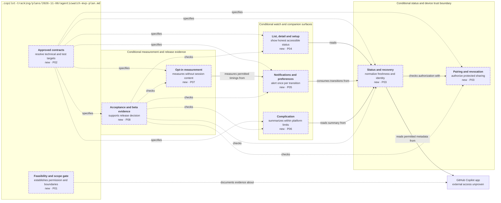

<!-- markdownlint-disable-file -->
# RPI Plan: AgenticWatch monitoring MVP

## Task Metadata

* Task ID: `AGENTICWATCH-MVP-PLAN-001`
* Task slug: `agenticwatch-mvp`
* Plan date: `2026-11-08`
* Primary planner: Picard; requested by Guy Bertental (`@guybartal`) through the coordinating parent.
* Source: [docs/prd/agenticwatch.md](../../../docs/prd/agenticwatch.md), `PRD-AGENTICWATCH-001`, draft `0.1.0`, handoff **Not ready**.
* Resolved plan path: `.copilot-tracking/plans/2026-11-08/agenticwatch-mvp-plan.md`.

## Executive Summary

**Initial planning artifact and authorized feasibility research complete; product implementation Not ready.** Public-source investigation found credible desktop hook, canvas-extension and experimental SDK leads, but did not establish a sufficient supported, read-only contract for existing desktop sessions. This is missing evidence, not proof that integration is impossible. Only after that evidence, resolved scope questions and an approved technical design should the team build secure pairing, reliable status, watch/companion views, notifications, complications, and privacy-preserving measurement.

The conditional MVP helps the user notice blocked sessions without returning to the Mac merely to check. Requirement coverage and sequencing are grounded in the draft PRD; feasibility, platform/stack, delivery guarantees, distribution, and precise implementation/test targets remain unproven. Complexity labels are relative planning judgments, not schedules or approved assignments.

### What You May Not Know

* The tracked repository contains the draft PRD and Squad scaffolding, not an established product implementation, technical design, BRD, ADR, or product test suite.
* Access to session status in this planning environment does not prove a supported external product integration.
* Private-repository ruleset creation is separately blocked by a GitHub plan restriction (`403`, upgrade to Pro); this is not a prerequisite to beginning authorized feasibility investigation.
* "Finished responding" means a response ended, not task success. Complications cannot promise real-time updates; a connected-watch notification must independently meet the 30-second p95 requirement.
* The PRD references personal Mac(s), but R3 lists multiple Macs as expansion while `Q-003` asks whether R1 includes them. This plan preserves that conflict for the user.

## Phase Checklist

All tasks are **planned and unchecked**. Guy authorized the bounded `P01` public-source investigation; its evidence is saved, but `P01-T01` remains incomplete because supported access has not been proven. `P02` is gated design work. `P03`–`P08` are conditional outcomes, **not yet executable implementation instructions**. Exact files, stack-specific commands, runtime contracts, supported versions, and bounded test additions must be supplied in `P02` before implementation readiness.

### After

Intended logical boundaries only, conditional on `ASM-001` and `P02` approval. Boxes other than this plan are responsibility boundaries, not committed services, repository directories, deployment units, or transport choices. No Before diagram: tracked sources show no product implementation or established connection path to replace.

Key: arrows point from a part to what it uses; dotted arrows describe or verify; dashed border means new conditional responsibility; tags identify contributing phases.

Watch surfaces (`P04`–`P06`) consume status (`P03`), which checks pairing authorization and reads only a proven permitted source. Feasibility (`P01`) and design (`P02`) describe and constrain these responsibilities; measurement (`P07`) and acceptance/beta evidence (`P08`) verify outcomes without adding session content. The diagram does not establish external access or select a Mac agent, relay, cloud service, Apple framework, or delivery mechanism.

<!-- rpi:phase id=P01 -->
### [ ] P01: Establish supported access and product scope

Goals:
* Establish whether the PRD is feasible without prohibited access, and make user-owned boundaries explicit before technical commitments.

Dependencies:
* None within the plan. Guy authorized bounded supported-access research; product decisions and any runtime verification remain separate gates.

Changes in the map: adds the feasibility and scope gate.

<!-- rpi:task id=P01-T01 -->
#### [ ] P01-T01: Prove the supported external status boundary

Goals:
* Produce a reproducible supported-access evidence record or an explicit no-go/remaining-evidence result for `ASM-001`.

Requirements:
* `FR-002`, `FR-004`, `FR-005`, `FR-006`, `FR-007`, `FR-012`; `NFR-001`, `NFR-003`, `NFR-007`, `NFR-010`, `NFR-015`; `CON-001`, `CON-004`; `DD-003`, `DD-005`.
* Gate evidence must identify a documented permitted external mechanism, its support/terms basis, required permissions, real observable states and transitions, stable session identity, timestamps/freshness limits, attention categories, and missing fields.
* No internal scraping, reverse engineering, private endpoints, credential extraction, or content-bearing exports as substitutes. Inability to prove a permitted mechanism blocks shipping, not permission to bypass the constraint.

Details:
* Suggested assignee: Data; Picard owns feasibility disposition; Worf verifies permission/privacy boundary; Fact Checker can verify claims in a later authorized assignment. Complexity: **L**, because source capability and cadence are unknown.
* Later investigation should distinguish authoritative documentation from observations and reproduce Working, input wait, approval wait, finished-response transition, unknown values, disconnect, and recovery with minimized/redacted evidence. App-session tools visible to planners are not product API evidence.
* Record what is unavailable, including state-entry timestamps or response-time events. Do not silently substitute poll-observation time for source-transition time or infer success from idle.
* Exit to design only when Picard records supported access sufficient for required behavior, or the user approves an explicit PRD revision. If access is unsupported, propose engagement with GitHub or scope reconsideration; do not implement an alternative secretly.

References:
* [docs/prd/agenticwatch.md](../../../docs/prd/agenticwatch.md): `PRD-AGENTICWATCH-001` draft, `ASM-001`, `ASM-002`, `DD-003`, `DD-005`, `CON-001`, `CON-004`, relevant FR/NFR above.
* [.squad/agents/picard/charter.md](../../../.squad/agents/picard/charter.md): validate access with Data before design.

Dependencies:
* No earlier task; separate investigation authorization required.

<!-- rpi:task id=P01-T02 -->
#### [ ] P01-T02: Resolve user-owned scope and measurement decisions

Goals:
* Establish an approved R1 boundary and record answers to `Q-001`–`Q-004` without inventing defaults.

Requirements:
* `FR-007`, `FR-008`, `FR-011`, `FR-013`; `NFR-007`, `NFR-009`, `NFR-011`, `NFR-014`, `NFR-016`; `CON-003`; `DD-001`, `DD-002`, `DD-004`.
* Preserve monitoring-only R1 and all four questions as unresolved until Guy answers; explicitly reconcile `Q-003` with R3 framing.

Details:
* Suggested assignee: Picard, with Guy as decision owner; Troi advises notification/setup trade-offs; Worf advises measurement/privacy. Complexity: **M**.
* Parent can relay independent product questions while access evidence is pending; completion of this task does not bypass `P01-T01`. Baseline feasibility and distribution consequences must reflect the access evidence before final approval.
* Record owner/reviewer sign-off responsibilities currently TBD in the PRD. No PRD editing or approval is implied by this initial plan.

References:
* [docs/prd/agenticwatch.md](../../../docs/prd/agenticwatch.md): `PRD-AGENTICWATCH-001` draft, `Q-001`–`Q-004`, R1/R3 framing, sign-off, `GOAL-001`–`GOAL-003`, identifiers above.
* [.squad/team.md](../../../.squad/team.md): roles and personal monitoring boundary.

Dependencies:
* None for initial question collection; final evidence-dependent decisions must incorporate `P01-T01` before `P02`.

<!-- rpi:phase id=P02 -->
### [ ] P02: Approve technical design and verification contracts

Goals:
* Translate proven capabilities and resolved product scope into approved, implementable contracts and a bounded evidence strategy.

Dependencies:
* `P01-T01`, `P01-T02` complete with evidence and required user decisions.

Changes in the map: adds approved contracts governing every conditional responsibility.

<!-- rpi:task id=P02-T01 -->
#### [ ] P02-T01: Define and approve the monitoring technical design

Goals:
* Establish concrete component boundaries, platform support, and contracts that satisfy the PRD without architecture-by-assumption.

Requirements:
* `FR-001`, `FR-002`, `FR-004`, `FR-005`, `FR-006`, `FR-007`, `FR-009`, `FR-010`, `FR-011`, `FR-012`, `FR-013`; `NFR-001`–`NFR-010`, `NFR-014`–`NFR-016`; `CON-001`–`CON-004`; `DD-001`–`DD-005`.
* Resolve identity and transition identity, timestamp provenance/clock handling, ordering/replay, freshness, reconnect reconciliation, revocation in-flight semantics, encrypted transport/storage, notification routing and lock disclosure, retention, and complication update limits.
* Account for source-to-watch latency under platform restrictions; no unsupported guarantee and no content collection to fill metadata gaps.

Details:
* Suggested assignee: Picard; Data and Geordi contribute integration/platform evidence, Troi surface contracts, Worf security review. Complexity: **L**.
* Select stack, supported macOS/iOS/watchOS versions, topology, delivery mechanism, and precise implementation paths only after the gate. Any operational metadata beyond the PRD's five fields needs a justified minimum, privacy review, and user approval where scope changes; timestamps/identifiers must not become a content loophole.
* Specify attention summaries as categories such as Question or Plan approval, not question text. Specify unknown-state fallback and freshness semantics for every surface, including retained disconnected snapshots.
* Resolve deduplication across retries/restarts/reconnects and permitted Mac count, consent/preference propagation, pairing ownership, secure persistence, and immediate stop-sharing behavior.
* Approval evidence must identify Guy/product sign-off, Picard technical acceptance, Worf quality/security review, Geordi platform feasibility, and required team consensus. Public distribution additionally needs the PRD's legal/compliance approval. Do not invent a prior ADR or approved design.

References:
* [docs/prd/agenticwatch.md](../../../docs/prd/agenticwatch.md): `PRD-AGENTICWATCH-001` draft, technical design deferred, referenced FR/NFR/CON/DD and sign-off.
* [.squad/decisions.md](../../../.squad/decisions.md): no active decisions; meaningful changes require team consensus.
* [.squad/routing.md](../../../.squad/routing.md): architecture/integration/platform/security ownership.

Dependencies:
* `P01-T01`, `P01-T02`.

<!-- rpi:task id=P02-T02 -->
#### [ ] P02-T02: Lock requirement fixtures, test targets, and evidence rules

Goals:
* Establish stack-specific tests and measurement definitions that can distinguish semantic correctness, regressions, and real device delivery before product work starts.

Requirements:
* `FR-001`–`FR-013`, `AC-001`–`AC-013`, `NFR-001`–`NFR-016`; `CON-002`, `CON-004`; `DD-003`.
* Test owner is **Worf**. Exact removals: **none**. Existing suite/test count: **not established**; no count or baseline pass is claimed.
* Maximum test additions and exact canonical/generated targets must be set and approved by Worf after stack selection, before readiness/critique. They are **unresolved now**, not an unlimited allowance or fabricated count.

Details:
* Suggested assignee: Worf; Data supplies supported-state fixtures, Geordi device/platform harnesses, Troi accessibility cases. Complexity: **M**.
* Semantic coverage: all four labels, wait categories, source vs observation clocks, transition identity, stale boundary, unknown values, ordering, consent, security, and negative cases. Regression coverage: once implementation exists, preserve working pairing, cache/persistence, reconnect, preferences, and alert history across approved version changes; do not mistake greenfield fixtures for proof of prior behavior.
* Canonical targets are approved source tests/fixtures; generated outputs derive from them and must not be hand-edited. There are no established product targets to name today. Select the smallest relevant existing runner once one exists; expand only when findings justify it.
* Define connected-watch conditions, supported-device/OS matrix, source-transition and watch-receipt evidence, synchronized clocks/uncertainty, sample size and reporting method for p95. A queued/sent event, iPhone receipt, simulator success, or mocked haptic does not prove Apple Watch delivery.
* Include real devices, locked/unlocked watch, permission denied, unreachable devices, source update cadence, sleep/wake and background restrictions. If delivery receipt evidence cannot be obtained via supported mechanisms, retain a verification blocker or seek an approved measurement revision.
* Worf defines synthetic/redacted data, security assertions, accessibility evidence, measured setup/list timing, and reproducible acceptance records. No tests, harness, or dependency installs run in this planning assignment.

References:
* [docs/prd/agenticwatch.md](../../../docs/prd/agenticwatch.md): `PRD-AGENTICWATCH-001` draft, full FR/AC/NFR catalogs and success metrics.
* [.squad/routing.md](../../../.squad/routing.md): Worf owns testing, duplicate-alert, latency, stale/recovery, and security evidence.

Dependencies:
* `P02-T01` approved design; then planner revises exact implementation tasks and runs standard critique only when otherwise implementation-ready.

<!-- rpi:phase id=P03 -->
### [ ] P03: Establish secure sharing and trustworthy status

Goals:
* Permit only explicitly paired devices to receive minimized data, and recover honest status without leaking content or presenting stale information as live.

Dependencies:
* `P02-T01`, `P02-T02`, required approvals, revised executable plan, and standard critique with blocking findings resolved.

Changes in the map: adds pairing and revocation, status and recovery.

<!-- rpi:task id=P03-T01 -->
#### [ ] P03-T01: Implement pairing, protected persistence, and revocation

Goals:
* Only explicitly paired personal devices receive protected status; disconnect/revoke stops future sharing and alerts from the Mac.

Requirements:
* `FR-011`, `FR-013`, `AC-011`, `AC-013`; `NFR-005`, `NFR-006`, `NFR-007`, `NFR-015`, `NFR-016`; `DD-001`, `DD-002`; `CON-004`.
* Revocation must satisfy no further status or notifications reaching the watch, including queued/in-flight paths as defined by approved design; do not weaken `AC-013` to a UI-only disconnect.

Details:
* Suggested assignee: Geordi, with Data on source boundary and Worf security/test ownership. Complexity: **L**.
* Implement the approved trust lifecycle, least permissions, approved protected storage/transport and removal of access on revoked devices. No new credential system or cryptographic primitive is assumed here.
* Worf tests unpaired/revoked-device denial, expired/replayed pairing attempts, ownership isolation, persisted protection, minimal data, and revocation during offline/retry/queued delivery conditions. UI setup consumes this capability in `P04-T01`.

References:
* [docs/prd/agenticwatch.md](../../../docs/prd/agenticwatch.md): `PRD-AGENTICWATCH-001` draft, cited pairing/revoke and privacy/security identifiers.
* [.squad/routing.md](../../../.squad/routing.md): Geordi/Data engineering and Worf security ownership.

Dependencies:
* `P02-T01`, `P02-T02`, plan readiness gate described in `P03`.

<!-- rpi:task id=P03-T02 -->
#### [ ] P03-T02: Implement normalized status, freshness, and automatic recovery

Goals:
* Consumers receive one honest state per session, its duration and freshness, and automatically reconciled attention state after temporary loss.

Requirements:
* `FR-002`, `FR-004`, `FR-005`, `FR-012`, `AC-002`, `AC-004`, `AC-005`, `AC-012`; `NFR-003`, `NFR-004`, `NFR-007`, `NFR-009`, `NFR-010`, `NFR-015`; `CON-001`, `CON-004`; `DD-003`.
* Current status is never older than 2 minutes; elapsed time **greater than 2 minutes** is visibly stale or Unknown/Offline. Unknown source values degrade to Unknown, never optimistic Working or Finished responding.
* Temporary loss recovers status and pending attention states without user action; new transitions remain distinct from replayed snapshots.

Details:
* Suggested assignee: Data; Geordi integrates the approved device delivery boundary; Worf owns tests. Complexity: **L**.
* Consume only the proven supported access mechanism. Enforce minimum payload, approved stable identity, state-entry time and last-refresh provenance; source success is not inferred from idle.
* Worf exercises boundary timestamps at/below/above 2 minutes, clock changes, reordered/duplicate updates, missing sessions, unknown schema/state, Mac/device/source loss and sleep/wake, and at least 25 concurrent sessions. Recovery cannot silently refresh an old snapshot timestamp to make it current.
* Establish transition semantics consumed by `P05`; any missing source capability returns to design instead of an unsupported workaround.

References:
* [docs/prd/agenticwatch.md](../../../docs/prd/agenticwatch.md): `PRD-AGENTICWATCH-001` draft, status/freshness/recovery identifiers above, `ASM-002`.
* [.squad/team.md](../../../.squad/team.md): honest labels and minimal-data context.

Dependencies:
* `P03-T01`; `P02-T01`, `P02-T02` and `P03` readiness gate.

<!-- rpi:phase id=P04 -->
### [ ] P04: Deliver guided companion setup and accessible watch views

Goals:
* A user can connect without configuration files and read trustworthy, attention-first session information quickly on Apple Watch.

Dependencies:
* `P03-T01`, `P03-T02`.

Changes in the map: adds list, detail and setup.

<!-- rpi:task id=P04-T01 -->
#### [ ] P04-T01: Implement companion setup, connection controls, and guidance

Goals:
* The iPhone companion guides setup and disconnect, and explains permissions or connectivity failures without exposing session content.

Requirements:
* `FR-011`, `FR-012`, `FR-013`, `AC-011`, `AC-012`, `AC-013`; `NFR-005`, `NFR-006`, `NFR-007`, `NFR-012`, `NFR-013`, `NFR-014`, `NFR-015`, `NFR-016`; `DD-001`, `DD-002`.
* A new user completes guided setup in **under 3 minutes**, without editing manual configuration files; all screens support VoiceOver/Dynamic Type.

Details:
* Suggested assignee: Geordi; Troi owns setup/accessibility design, Worf tests. Complexity: **M**, provisional on approved pairing design.
* Use approved R1 Mac-count behavior; do not add multiple-Mac onboarding while `Q-003` remains open. Make disconnected/denied/revoked states understandable and ensure controls act on the trust lifecycle.
* Worf measures new-user setup on supported real devices and verifies permission-denied, retry, revoke, accessibility and minimal disclosure flows.

References:
* [docs/prd/agenticwatch.md](../../../docs/prd/agenticwatch.md): `PRD-AGENTICWATCH-001` draft, cited setup/connection identifiers, `ASM-004`.
* [.squad/routing.md](../../../.squad/routing.md): Geordi companion and Troi setup ownership.

Dependencies:
* `P03-T01`, `P03-T02`.

<!-- rpi:task id=P04-T02 -->
#### [ ] P04-T02: Implement watch list, detail, and freshness presentation

Goals:
* Users see active sessions ordered by attention and inspect state duration and safe attention category, with readable accessible freshness.

Requirements:
* `FR-001`–`FR-005`, `FR-012`, `AC-001`–`AC-005`, `AC-012`; `NFR-002`, `NFR-003`, `NFR-007`, `NFR-009`, `NFR-012`, `NFR-013`, `NFR-016`; `DD-003`.
* List opens and is readable in **at most 2 seconds**; supports **at least 25 concurrent sessions** without degrading readability or notification timeliness.
* Order is Needs you, Working, Finished responding, Unknown/Offline; exactly one honest label per session, icons/text beyond color, and last-updated time in every status view.

Details:
* Suggested assignee: Geordi; Troi owns UX/accessibility, Worf tests. Complexity: **L**.
* Worf covers `AC-001` with three active sessions, mixed ordering, plan-approval detail, large session counts, long names, Dynamic Type, VoiceOver, stale/offline presentation, and measured readability on devices. Do not render actual question text.
* Use approved freshness/cached-state contract; displaying cached information must not imply currentness. Mock UI timing is preliminary, not final device evidence.

References:
* [docs/prd/agenticwatch.md](../../../docs/prd/agenticwatch.md): `PRD-AGENTICWATCH-001` draft, referenced watch-view FR/AC/NFR and honest-state glossary.
* [.squad/routing.md](../../../.squad/routing.md): Geordi watch/Troi accessibility/Worf acceptance ownership.

Dependencies:
* `P03-T02`, `P04-T01` for integrated paired-user evidence.

<!-- rpi:phase id=P05 -->
### [ ] P05: Deliver timely, private, nonduplicating notifications

Goals:
* State transitions notify according to approved preferences, with trustworthy watch delivery and bounded disclosure/replay.

Dependencies:
* `P03-T02`, `P04-T01`, `P04-T02`.

Changes in the map: adds notifications and preferences.

<!-- rpi:task id=P05-T01 -->
#### [ ] P05-T01: Implement watch notifications and preference controls

Goals:
* Needs-you and enabled Finished-responding alerts follow per-type/per-session preferences, without prohibited locked-watch disclosure.

Requirements:
* `FR-006`, `FR-007`, `FR-008`, `AC-006`, `AC-007`, `AC-008`; `NFR-001`, `NFR-007`, `NFR-008`, `NFR-009`, `NFR-012`, `NFR-013`; `CON-002`; `DD-003`, `DD-004`.
* Connected-watch Needs-you events arrive within **30 seconds for at least 95% of events (p95 ≤30 seconds)**. With 25 or more concurrent sessions, required notification timeliness still holds.
* Locked-watch notifications reveal **no more than session name and state**; attention type is available only where disclosure is allowed. Notifications never include project/attention text on locked watch or any prompts/responses/code/files anywhere.
* Finished notification triggers on Working → Finished responding when enabled; its default remains `Q-001` until answered.

Details:
* Suggested assignee: Geordi; Troi preferences/copy, Data transition integration, Worf delivery/privacy tests. Complexity: **L**.
* Apply settings to future notifications; cover each type on/off and all/selected-session choices. Needs-you alerts include haptic, name and attention category under permitted unlocked presentation.
* Worf verifies actual supported-watch receipt/haptics and locked/unlocked payload rendering, denied permissions, app foreground/background, and supported routing conditions. Measure full source-transition-to-watch latency, not send-to-provider latency.

References:
* [docs/prd/agenticwatch.md](../../../docs/prd/agenticwatch.md): `PRD-AGENTICWATCH-001` draft, notifications and disclosure identifiers, `Q-001`, `CON-002`.
* [.squad/routing.md](../../../.squad/routing.md): platform notification and quality ownership.

Dependencies:
* `P03-T02`, `P04-T01`, `P04-T02`, resolved `Q-001` and `P02` delivery contract.

<!-- rpi:task id=P05-T02 -->
#### [ ] P05-T02: Implement persistent deduplication and recovered attention

Goals:
* Replayed/retried updates cannot duplicate alerts, while genuinely new transitions and pending attention recover correctly.

Requirements:
* `FR-006`, `FR-007`, `FR-008`, `FR-009`, `FR-012`, `FR-013`, `AC-006`–`AC-009`, `AC-012`, `AC-013`; `NFR-001`, `NFR-003`, `NFR-004`, `NFR-005`, `NFR-009`.
* **At most one notification per state change per session**; exactly one for the enabled eligible single-transition `AC-009` scenario, and zero when disabled, unselected, or revoked.
* Automatic reconnect restores status/pending attention without user action, duplicate alerts, fabricated new transitions, or revoked-Mac sharing.

Details:
* Suggested assignee: Data and Geordi (Data primary for transition identity); Worf test owner. Complexity: **L**.
* Implement the approved transition ledger/identity contract, not dedupe solely by display name or current state. Separate recurring real Needs-you transitions from duplicate transport deliveries.
* Worf exercises retries, restart/persistence, out-of-order replay, repeated same-state snapshots, disconnect/reconnect, preference changes, queued delivery/revoke races, and approved Mac count. Reconcile offline pending notifications with design's expiry/freshness rules; offline events do not prove connected-watch p95.

References:
* [docs/prd/agenticwatch.md](../../../docs/prd/agenticwatch.md): `PRD-AGENTICWATCH-001` draft, dedupe/recovery/revoke and latency identifiers.
* [.squad/routing.md](../../../.squad/routing.md): Worf duplicate alerts and recovery ownership.

Dependencies:
* `P05-T01`, `P03-T01`, `P03-T02`.

<!-- rpi:phase id=P06 -->
### [ ] P06: Add trustworthy complication summaries

Goals:
* Users can glance at attention count and working presence without mistaking platform-limited refresh for real-time status.

Dependencies:
* `P04-T02`, `P05-T02`.

Changes in the map: adds the complication.

<!-- rpi:task id=P06-T01 -->
#### [ ] P06-T01: Implement accessible, freshness-aware complications

Goals:
* Complications summarize needs-you count and any Working sessions within approved platform refresh limits.

Requirements:
* `FR-010`, `FR-002`, `FR-005`, `FR-012`, `AC-010`, `AC-002`, `AC-005`, `AC-012`; `NFR-003`, `NFR-007`, `NFR-012`, `NFR-013`, `NFR-016`; `CON-002`; `DD-003`, `DD-004`.
* `AC-010` shows a count of 2 for two needs-you sessions within platform update limits; stale data cannot be presented as current.

Details:
* Suggested assignee: Geordi; Troi glance/accessibility design, Worf tests. Complexity: **M**.
* Approved design must reconcile platform scheduling with stale display; cached complication snapshots need an honest stale/unknown representation after 2 minutes. No real-time promise or weakening of `NFR-003`.
* Worf validates count/working summary, no-color-only distinction, privacy and actual supported-watch refresh behavior. Notifications remain the time-critical surface, not complication refresh.

References:
* [docs/prd/agenticwatch.md](../../../docs/prd/agenticwatch.md): `PRD-AGENTICWATCH-001` draft, complication, freshness, accessibility identifiers and `CON-002`.
* [.squad/routing.md](../../../.squad/routing.md): Geordi complication and Troi glance design ownership.

Dependencies:
* `P04-T02`, `P05-T02`, approved `P02` complication/freshness contract.

<!-- rpi:phase id=P07 -->
### [ ] P07: Establish opt-in privacy-preserving measurement

Goals:
* Measure timely alerts and reduced waiting using approved consent/baseline methods, without collecting content.

Dependencies:
* `P05-T02`; resolved `Q-002` and approved `P02` measurement contract.

Changes in the map: adds opt-in measurement.

<!-- rpi:task id=P07-T01 -->
#### [ ] P07-T01: Implement consented latency and response-time measurement

Goals:
* Opt-in telemetry can measure notification delivery latency and time to user response without session content or unauthorized observation.

Requirements:
* `NFR-001`, `NFR-006`, `NFR-007`, `NFR-008`, `NFR-011`; `CON-001`, `CON-004`; `GOAL-001`, `GOAL-003`.
* Opt-in only; no prompts/responses/code/files in telemetry, logs, fixtures, diagnostics or watch payloads. Timing instrumentation must not collect content-bearing exports.

Details:
* Suggested assignee: Data; Geordi supplies approved watch delivery measurement, Worf privacy/test ownership, Picard metric contract. Complexity: **M**, conditional on supported response-event access.
* Implement approved consent, minimized correlation data, retention/deletion and baseline method. Session/project names are not automatically required for telemetry merely because watch payloads permit them.
* Worf verifies opt-out/no emission, withdrawn consent, data minimization, clock uncertainty, latency definition, and evidence of real user response via supported metadata or approved user-reported method. If a valid response timestamp or delivery evidence is unavailable, retain a metric blocker rather than relabel source observation as truth.
* Compare the PRD's median Needs-you-to-response improvement with the approved baseline; do not claim causality or target attainment from a simulator.

References:
* [docs/prd/agenticwatch.md](../../../docs/prd/agenticwatch.md): `PRD-AGENTICWATCH-001` draft, `NFR-011`, `Q-002`, `GOAL-001`, success-metric definitions.
* [.squad/routing.md](../../../.squad/routing.md): Data integration and Worf privacy/quality responsibilities.

Dependencies:
* `P05-T02`, `P02-T02`, resolved `Q-002`.

<!-- rpi:phase id=P08 -->
### [ ] P08: Verify acceptance and decide beta/distribution readiness

Goals:
* Establish reproducible product/security/device evidence and a user-approved release path, without representing planned tests or beta targets as passed.

Dependencies:
* `P04`–`P07` complete; `P03` security/recovery evidence available.

Changes in the map: adds acceptance and beta evidence.

<!-- rpi:task id=P08-T01 -->
#### [ ] P08-T01: Verify all acceptance and quality thresholds

Goals:
* Produce Worf-owned evidence for the entire FR/AC/NFR boundary on the approved platform/device matrix.

Requirements:
* `FR-001`–`FR-013`, `AC-001`–`AC-013`, `NFR-001`–`NFR-016`, `CON-001`–`CON-004`, `DD-001`–`DD-005`.
* Required measured thresholds: connected-watch Needs-you **p95 ≤30 seconds**, readable list **≤2 seconds**, stale **>2 minutes**, **≥25 concurrent sessions**, setup **<3 minutes**, at most one alert per transition, and zero alerts/sharing after revoke or for disabled preferences.
* Required behavior: automatic status/pending-attention recovery, unknown-value degradation, explicitly paired-only protected data, locked-watch name/state-only disclosure, minimal payload, VoiceOver/Dynamic Type, and approved macOS/Apple Watch/iPhone compatibility.

Details:
* Suggested assignee: **Worf**; Geordi real-device evidence, Data supported-source traces, Troi accessibility/readability assessment, Picard readiness reconciliation. Complexity: **L**.
* Execute the locked `P02-T02` suite, not invented commands. Keep semantic assertions separate from regression checks and source/device/notification delivery measurements. No removals; preserve canonical tests and generate derived targets as approved.
* Verify all 13 AC with reproducible scenarios, plus NFR coverage AC alone does not provide. Include security negative cases, replay/race recovery, 25-session load, locked-watch delivery, permissions/background restrictions and stale complication behavior.
* Record actual runner/environment/sample sizes and failures; unsupported devices or unobservable delivery remain limitations/blockers. Mock/source-only/simulator results cannot pass physical-watch latency/haptic/disclosure gates.

References:
* [docs/prd/agenticwatch.md](../../../docs/prd/agenticwatch.md): `PRD-AGENTICWATCH-001` draft, complete FR/AC/NFR catalog; all AC currently Not Started.
* [.squad/routing.md](../../../.squad/routing.md): Worf owns testing/security and Picard/Worf review.

Dependencies:
* `P03-T01`, `P03-T02`, `P04-T01`, `P04-T02`, `P05-T01`, `P05-T02`, `P06-T01`, `P07-T01`, locked `P02-T02` targets.

<!-- rpi:task id=P08-T02 -->
#### [ ] P08-T02: Evaluate beta outcomes and approved distribution

Goals:
* Give Guy an evidence-backed release/support decision within personal R1 scope and approved distribution constraints.

Requirements:
* `FR-001`–`FR-013`; `NFR-001`, `NFR-009`, `NFR-011`, `NFR-014`, `NFR-015`, `NFR-016`; `CON-003`; `DD-001`, `DD-002`; `GOAL-001`–`GOAL-003`.
* Preserve PRD targets: median time-to-respond improves **≥50% versus approved baseline within 4 weeks**; **≥70%** report fewer checking trips after **2 weeks**; **≥90%** rate Needs-you/Finished-responding notifications accurate and timely in beta. Weekly active use target **≥60% of installers over 4 weeks** remains a metric, not fabricated evidence.

Details:
* Suggested assignee: Picard; Troi beta feedback, Worf quality/sign-off, Geordi distribution feasibility. Complexity: **M**; no launch date or cohort size is claimed.
* Beta protocol, cohort/sample adequacy and the PRD's deferred SMART evaluation need approved definitions before enrollment. Personal-use scope is not permission to expand into team/shared monitoring.
* Apply Guy's `Q-004` answer, Apple policy constraints and required public legal/compliance approval. Packaging/signing/support details depend on approved platform and distribution; open source alone does not prove install/distribution viability.
* Publish actual limitations and gate results for Guy's release decision. Goal windows are measurement windows after adoption, not promised delivery dates.

References:
* [docs/prd/agenticwatch.md](../../../docs/prd/agenticwatch.md): `PRD-AGENTICWATCH-001` draft, success metrics, `Q-002`, `Q-004`, `ASM-003`, `ASM-004`, sign-off.
* [.squad/team.md](../../../.squad/team.md): personal Apple Watch/iPhone product context.

Dependencies:
* `P08-T01`, `P07-T01`, resolved `Q-004`, approved beta/SMART protocol and required sign-offs.

## User Decisions and Requirements

### Confirmed User Direction

* Start planning the PRD; no production implementation, issues, PRs, commits or branch switching.
* Guy subsequently selected "Investigate supported access first (Recommended)"; bounded supported-access research was authorized and completed. No runtime probe, unsupported fallback or product scope change was authorized.
* `R1`, `DD-001`–`DD-005`: monitoring only, personal use, Apple Watch with an iPhone companion, four honest labels, no unsupported/terms-violating Copilot access.
* `NFR-007`: minimum payload; no prompts, responses, code, or file contents.
* `ASM-001` is the first hard gate; stack, supported OS versions, and product implementation wait for proven supported access and approved technical design.

### Planning Decisions and Feedback

| Group | Decision or feedback item | Status | Owner | Rationale or input needed | Evidence | Planning impact |
|---|---|---|---|---|---|---|
| D1 | Supported external status access (`ASM-001`) | Investigation authorized and completed; contract unresolved | Data supplies evidence; Picard owns gate; Guy retains scope decisions | Obtain vendor-supported desktop applicability, read-only permission, snapshot/events, timestamps and recovery contract; do not infer exhaustive absence | [Research findings F1–F6](../../research/2026-11-08/agenticwatch-status-access-research.md); `CON-004`; Guy's recorded choice | `P01-T01` remains unchecked; `P02-T01` and product work remain gated |
| D2 | `Q-003`: one or more Macs in R1 | User-owned; unresolved | Guy | Reconcile DD-002 personal Mac(s) with R3 expansion | PRD release framing | `P01-T02`, `P02-T01`, `P03-T01`, `P03-T02`, `P04-T01`, `P05-T02` |
| D3 | `Q-001`: finished-notification default | User-owned; unresolved | Guy | Default affects fatigue; enabled behavior is still required | PRD open questions and `AC-007`/`AC-008` | `P01-T02`, `P05-T01` |
| D4 | `Q-002`: baseline measurement | User-owned; unresolved | Guy | Define feasible pre-adoption comparison without content collection | PRD success metrics and `NFR-011` | `P01-T02`, `P02-T02`, `P07-T01`, `P08-T02` |
| D5 | `Q-004`: distribution | User-owned; unresolved | Guy | Personal tool, open source, or App Store product; support/install/policy consequences | PRD questions, `CON-003`, sign-off | `P01-T02`, `P02-T01`, `P08-T02` |
| D6 | Technical design and contracts | Pending feasibility and scope; no selection approved | Picard proposes; team/reviewers/Guy approve | Establish topology/stack/OS targets, privacy envelope and delivery/recovery contracts | `DD-005`; no active Squad decisions | `P02-T01`, all `P03`–`P08` |
| D7 | Exact test targets, bounded additions and device/metric evidence | Unresolved pending design | Worf owns; Picard incorporates | Lock canonical/generated paths, maximum additions, test runner, devices, clock/sample method; removals none | `P02-T02`; no product suite established | `P02-T02`, `P08-T01`, readiness/critique |
| D8 | Beta/SMART and sign-off protocol | Deferred; approval not given | Guy, Picard and Worf | Define reviewers, cohort adequacy and evidence for PRD's deferred SMART evaluation; legal/compliance if public | PRD SMART/sign-off/metrics | `P01-T02`, `P08-T02` |

Decision groups organize existing PRD identifiers; they do not create new product requirements. The following question contexts are prepared **for the parent to relay**, not questions asked or answered by this sub-agent.

#### D1: First gating decision

Guy authorized the bounded supported-access investigation. Data completed it in [the research artifact](../../research/2026-11-08/agenticwatch-status-access-research.md).

Official desktop hooks and canvas extensions, plus experimental SDK peer/events APIs, are credible leads, not a verified complete existing-desktop status contract. Missing evidence includes all-session coverage, app/project identity, read-only permission, source state-entry times, current wait snapshots and reconnect recovery. Neither connected-watch latency nor source freshness has been demonstrated.

The next blocker-clearing evidence is a GitHub-supported desktop endpoint or sanctioned extension/event contract covering those fields and lifecycle guarantees. A product scope revision is a user-owned alternative, not an approved fallback. No vendor outreach or runtime verification has been performed.

#### D2: R1 Mac count (`Q-003`)

Does R1 include one Mac or more than one Mac?

* A: One Mac; leave multi-Mac expansion to R3 and clarify personal Mac(s) language.
* B: Multiple personal Macs; explicitly revise R1/R3 framing and design identity, pairing/revoke and event isolation accordingly.

No option is selected; the contradiction cannot be resolved by the planner silently.

#### D3: Finished-alert default (`Q-001`)

Should Finished responding notifications be enabled by default?

* A: Enabled; proactive completion awareness, with explicit opt-out.
* B: Disabled; lower initial alert volume, with explicit opt-in.

Both preserve enabled behavior required by `FR-007`/`AC-007`; "Finished responding" must not imply success.

#### D4: Pre-adoption baseline (`Q-002`)

Which privacy-preserving baseline method should be approved once supported response-event availability is known?

* A: Consented pre-enable measurement, only if supported metadata permits valid timing.
* B: Approved user-reported baseline protocol, acknowledging precision/comparability limits.
* C: Another user-approved method or explicit metric revision if neither is feasible.

The PRD's first-week pre-enable wording is not an approved measurement implementation. No content collection is an acceptable shortcut.

#### D5: Distribution (`Q-004`)

Is this a personal tool, open-source project, or App Store product?

* A: Personal tool; resolve viable installation/signing/support for the user.
* B: Open source; additionally resolve public packaging/support/compliance.
* C: App Store product; resolve review, signing, legal/compliance and support obligations.

All retain Apple policy constraints and personal single-user R1 behavior; no channel or release commitment is selected.

## Planning Readiness and Next Step

| Field | Record |
|---|---|
| Planning execution | **Complete initial planning artifact and bounded public-source feasibility investigation**; no product execution |
| Implementation readiness | **Not ready**; source PRD draft handoff is also Not ready |
| Decision participation | `user-owned`, explicitly retained by parent; parent relays questions, no sub-agent user prompting |
| Blockers | `ASM-001` investigated but unproven: sufficient supported existing-desktop contract missing; `Q-001`–`Q-004` unanswered; approved technical design, exact test/implementation targets, evidence protocol and required approvals absent |
| Gates | `P01` feasibility/scope → `P02` approved design/test contracts and executable-plan revision → standard critique → conditional `P03`–`P08`; no gate passed |
| Latest critique | Standard **not run / awaiting readiness**; no verdict or artifact |
| Relevant research | [.copilot-tracking/research/2026-11-08/agenticwatch-status-access-research.md](../../research/2026-11-08/agenticwatch-status-access-research.md): completed bounded investigation, F1–F6; missing-evidence result, not impossibility proof |
| Plan | `.copilot-tracking/plans/2026-11-08/agenticwatch-mvp-plan.md` |
| Changes-record role | Future `.copilot-tracking/changes/2026-11-08/agenticwatch-mvp-changes.md` would record implementation evidence; absent and not created by planning |
| Continuation owner | Coordinating parent/Guy for decisions and authorization; Picard for plan revision/readiness |
| Next action | Obtain GitHub-supported desktop status contract meeting research F6, or resolve an explicit user-owned scope revision; no automatic implementation handoff |
| Explicit no-handoff reason | Product instructions cannot responsibly be executable until supported access, scope, design/contracts and test/evidence targets exist; do not invoke implementation now |

The initial task is useful despite downstream blockers: it defines the precise first evidence record, decision groups, specialist ownership, coverage and dependency order. Planning completion is not PRD sign-off, feasibility success, implementation readiness, or permission to launch tasks.

## Goals

* `GOAL-001`: reduce blocked waiting; measure the approved baseline before claiming improvement.
* `GOAL-002`: reduce needless checking through useful notification/glance surfaces.
* `GOAL-003`: trustworthy, glanceable status with honest labels, freshness and delivery evidence.
* Make the first evidence/decision work explicit and retain complete PRD traceability without implying executable product work.

## Scope and Non-Goals

### In Scope

* This assignment: one durable initial plan and the subsequently authorized bounded feasibility research in the current worktree.
* Conditional product boundary: R1 monitoring of the user's own Copilot app sessions on macOS, Apple Watch plus iPhone companion, all 13 FR and 16 NFR, safe pairing/revocation, status/freshness/recovery, notifications, complications, measurement and approved acceptance/beta/distribution.
* Mac count remains `Q-003`; minimum payload and supported-only integration remain binding.

### Non-Goals

* No product code, stack/OS selection, issues/PRs/commits, runtime probing or team metadata changes.
* R2 watch actions (answers, approvals, stopping, prompts); conversation/diff/file viewing, starting sessions, standalone watch, other wearables, shared/team monitoring.
* R3 cloud-session expansion, Live Activities and richer progress; multi-Mac placement awaits `Q-003`, not silently included or excluded.
* Unsupported/terms-violating access, internal scraping/reverse engineering, arbitrary cloud/relay architecture, or weakening PRD thresholds.

## Functional Requirements

The canonical definitions are in [docs/prd/agenticwatch.md](../../../docs/prd/agenticwatch.md), `PRD-AGENTICWATCH-001` draft `0.1.0`. These are traceability summaries using **the same identifiers**, not new or conflicting definitions. Corresponding `AC-001`–`AC-013` retain PRD scenarios and Not Started status.

| PRD identifier | Requirement summary | Primary implementation task | Acceptance evidence |
|---|---|---|---|
| `FR-001` | Active session watch list with name/project/status | `P04-T02` | `AC-001`, `P08-T01` |
| `FR-002` | Exactly one of four honest states | `P03-T02`, `P04-T02` | `AC-002`, `P08-T01` |
| `FR-003` | Needs you → Working → Finished responding → Unknown ordering | `P04-T02` | `AC-003`, `P08-T01` |
| `FR-004` | Detail with duration and safe attention category | `P03-T02`, `P04-T02` | `AC-004`, `P08-T01` |
| `FR-005` | Last-updated time in every status view | `P03-T02`, `P04-T02`, `P06-T01` | `AC-005`, `P08-T01` |
| `FR-006` | Needs-you transition haptic notification/name/attention kind | `P05-T01`, `P05-T02` | `AC-006`, `P08-T01` |
| `FR-007` | Enabled Working → Finished responding notification | `P05-T01`, `P05-T02` | `AC-007`, `P08-T01` |
| `FR-008` | Each notification type on/off, all/selected sessions | `P05-T01`, `P05-T02` | `AC-008`, `P08-T01` |
| `FR-009` | At most one alert per state change per session | `P05-T02` | `AC-009`, `P08-T01` |
| `FR-010` | Complication attention count and any Working presence | `P06-T01` | `AC-010`, `P08-T01` |
| `FR-011` | Guided Mac connection without manual config files | `P03-T01`, `P04-T01` | `AC-011`, `P08-T01` |
| `FR-012` | Visible disconnected/stale rather than outdated-as-current | `P03-T02`, `P04-T02`, `P06-T01` | `AC-012`, `P08-T01` |
| `FR-013` | Disconnect/revoke stops sharing and notifications | `P03-T01`, `P05-T02` | `AC-013`, `P08-T01` |

## Non-Functional Requirements

Canonical source and identifiers remain the PRD above. `P02-T02` establishes measurement conditions; `P08-T01` verifies every row without inventing a baseline pass.

| PRD identifier | Exact threshold or required property | Primary task(s) / evidence conditions |
|---|---|---|
| `NFR-001` | Needs-you watch arrival ≤30 seconds for ≥95% of connected-watch events; p95 ≤30 seconds | `P05-T01`, `P07-T01`, `P08-T01`; real source-to-watch receipt evidence, clock/sample protocol |
| `NFR-002` | Session list opens and is readable ≤2 seconds | `P04-T02`, `P08-T01`; real-device readability/timing |
| `NFR-003` | Current status never older than 2 minutes; >2 minutes visibly stale | `P03-T02`, `P04-T02`, `P06-T01`; boundary/clock/cache tests |
| `NFR-004` | Temporary connection loss recovers status and pending attention without user action | `P03-T02`, `P05-T02`; reconnect/replay evidence |
| `NFR-005` | Only explicitly paired devices receive status | `P03-T01`; unpaired/revoked negative cases |
| `NFR-006` | Protected in transit and at rest on companion devices | `P03-T01`, `P07-T01`; approved protection/storage verification |
| `NFR-007` | Only minimum session name, project name, state, state duration, attention type; never prompts/responses/code/files sent to watch | `P03-T01`, `P03-T02`, `P05-T01`, `P07-T01`; minimized metadata contract and payload/log/telemetry checks |
| `NFR-008` | Locked-watch notification reveals no more than session name and state | `P05-T01`; real locked-watch rendering evidence |
| `NFR-009` | ≥25 concurrent sessions without degrading list readability or notification timeliness | `P03-T02`, `P04-T02`, `P05-T01`; integrated load plus same readability/latency gates |
| `NFR-010` | Changed Copilot status values gracefully degrade to Unknown | `P03-T02`; unknown-schema/state fixtures, no optimistic mapping |
| `NFR-011` | Opt-in privacy-preserving delivery-latency and response-time telemetry | `P07-T01`; supported timing evidence, approved `Q-002`, no-content/consent tests |
| `NFR-012` | States distinguished by icons/text, not color alone | `P04-T01`, `P04-T02`, `P06-T01`; visual and assistive evaluation |
| `NFR-013` | All screens support VoiceOver and Dynamic Type | `P04-T01`, `P04-T02`, `P05-T01`, `P06-T01`; approved device accessibility evidence |
| `NFR-014` | New-user setup <3 minutes | `P04-T01`, `P08-T01`; measured guided first-use setup, no manual config |
| `NFR-015` | Works with Copilot app on macOS; supported OS versions set by technical design | `P01-T01`, `P02-T01`, `P03`/`P04`; compatibility matrix remains unset |
| `NFR-016` | Apple Watch with iPhone companion; no standalone watch/other wearables in R1 | `P02-T01`, `P04`, `P06-T01`, `P08`; approved device matrix |

Range citations in task Requirements mean every identifier in the inclusive range. Each FR maps to its same-numbered AC and the PRD's original GOAL mapping; no additional FR/NFR/AC identifiers are introduced. All four `CON` and five `DD` are consumed by `P01`/`P02` and relevant implementation tasks.

## Risks and Open Questions

| Priority | Type | Risk/question | Affected work | Impact | Smallest clearing evidence/action | Owner |
|---|---|---|---|---|---|---|
| High | Feasibility blocker | `ASM-001` investigated but unproven; sufficient supported existing-desktop contract missing | `P01-T01`, `P02`, all product tasks | Cannot ship as designed | Vendor-supported contract meeting research F6, followed by authorized minimum-metadata verification | Data/Picard; Guy retains scope decisions |
| High | Decision | `Q-003` conflicts with R3 multi-Mac framing | `P01-T02`, `P02-T01`, `P03`, `P05-T02` | Identity/scope cannot be finalized | Guy answers and approves reconciled framing | Guy; parent relays |
| Medium | Decision | `Q-001` default unresolved | `P01-T02`, `P05-T01` | Fatigue/expected settings | Guy chooses default | Guy |
| High | Decision/evidence | `Q-002`, response baseline and source-to-watch timing unproven | `P02-T02`, `P07-T01`, `P08` | KPI/latency claims may be unverifiable | Approved baseline and supported timestamp/receipt method with uncertainty/sample protocol | Guy/Data/Worf |
| High | Decision | `Q-004` distribution unresolved | `P02-T01`, `P08-T02` | Signing/install/support/legal path unknown | Guy chooses scope/channel; required approvals recorded | Guy/Picard |
| High | Platform risk | Background/delivery/complication restrictions vs latency/freshness | `P02-T01`, `P05-T01`, `P06-T01`, `P08-T01` | 30-second p95 or honest stale display may be infeasible | Supported mechanism evidence and real-device trials in later authorized work | Geordi/Worf |
| High | Security risk | Queued alerts after revoke or locked-watch overdisclosure | `P02-T01`, `P03-T01`, `P05`, `P08-T01` | Violates `AC-013`/`NFR-008` | Approved revocation/privacy contracts plus negative/race/device tests | Worf/Geordi |
| High | Readiness gap | No approved design, exact source/test targets, bounded test additions or platform commands | `P02-T01`, `P02-T02`, all `P03`–`P08` | Conditional tasks not executable yet | Approved design and Worf target/addition budget; revise plan before critique | Picard/Worf |
| Medium | Assumption | `ASM-002`: useful state/duration semantics partially supported; idle misread as success | `P01-T01`, `P03-T02`, `P04-T02`, `P05` | Misleading monitoring | Supported-state evidence, honest mapping/copy and beta interpretation | Data/Troi/Worf |
| Medium | Assumption | `ASM-003` watch demand, `ASM-004` companion acceptance | `P04-T01`, `P08-T02` | Adoption/setup friction | Approved small-beta feedback and measured setup, no invented results | Troi/Guy |
| Medium | Approval gap | PRD draft, SMART deferred, reviewers/sign-off TBD | `P01-T02`, `P02`, `P08-T02` | No product/release approval | Assign required approvers and approve protocol/source revisions | Guy/Picard/Worf |

## Dependencies

* Supported/terms-compliant external access is the first hard gate; no production work substitutes for its evidence.
* User decisions are parallelizable as questions, but final design depends on resolved `Q-001`–`Q-004` and verified capabilities.
* Approved technical, privacy/security and test contracts precede all conditional product work. Exact test targets/addition budget remain a readiness prerequisite.
* Secure sharing/revocation precedes status consumption; normalized status precedes views; paired-user views precede integrated notifications; durable dedupe/recovery precedes complications and telemetry acceptance.
* Acceptance requires all product paths and actual physical-device notification evidence; beta/distribution requires acceptance, measurement protocol, product decision and sign-offs.
* No repository-rule upgrade, arbitrary stack, cloud backend, exact delivery date, or one-day estimate is a prerequisite asserted by this plan.

## Sources

* [docs/prd/agenticwatch.md](../../../docs/prd/agenticwatch.md): draft product requirements and unresolved handoff.
* [.squad/agents/picard/charter.md](../../../.squad/agents/picard/charter.md): feasibility before design.
* [.squad/decisions.md](../../../.squad/decisions.md): no active architecture decisions.
* [.squad/team.md](../../../.squad/team.md): specialist ownership and boundaries.
* [.squad/routing.md](../../../.squad/routing.md): integration gate, quality ownership, no scope expansion.
* Parent assignment: confirmed constraints, ruleset restriction, no execution/delegation; overrides routine routing ceremony for this bounded task.
* Tracked-file inventory (`git ls-files`) and initial clean worktree status: no product implementation, product dependency manifest, BRD, ADR, technical design or research artifact found among tracked files. Squad templates/workflows are not product architecture or evidence of an existing product test suite. Config/secret files were not read.
* RPI Plan skill's `templates/implementation-plan.md` and `references/planning.md`: artifact order, task blocks, decision/readiness/critique and map conventions. Installed tooling guidance is not product support evidence.

Business source status: only `PRD-AGENTICWATCH-001` draft `0.1.0` is established, explicitly Not ready. `source_brd_id` is null; no BRD/ADR/approved technical design is established. Task-local PRD citations are planning inputs, not implementation authorization. No external architecture or API claim has been verified here.

## Critique Disposition

* Setting: `standard`, default and parent-confirmed.
* Status: **not run / awaiting readiness**, not skipped or passed.
* Verdict: unavailable. No critique artifact exists. Initial draft is not implementation-ready.
* Planned critique path when eligible: `.copilot-tracking/reviews/plans/2026-11-08/agenticwatch-mvp-plan-critique.md`; not linked because absent.
* Findings: none produced; this is **not** a no-findings verdict. Earlier critiques: none.
* Readiness trigger: supported access/scope settled, technical and test contracts approved, exact targets/addition budget and evidence protocol recorded, conditional tasks revised to executable instructions; then one standard critique. Resolve Critical/High findings before product handoff.
* Test boundary retained: Worf owner, removals none, additions/targets pending approved stack, semantic vs regression evidence separated, real device/watch delivery required. No critique execution or extra artifact is authorized in this initial assignment.

## Artifact Self-Check

* [x] Executive summary and checklist distinguish initial-plan completion from Not ready implementation.
* [x] Confirmed boundaries and decision provenance recorded; unanswered `Q-001`–`Q-004` preserved and routed to parent/Guy.
* [x] All 13 FR, 13 AC and 16 NFR covered by task-local Requirements; original identifiers/thresholds retained without new definitions.
* [x] All phases have Goals, Dependencies and matching map changes; tasks have Goals, Requirements, Details, References and Dependencies in order, suggested assignee and S/M/L complexity.
* [x] Phase/task dependency references resolve, have no cycles, and enforce feasibility/design before product work.
* [x] Existing-file links resolve relative to plan; absent future paths use backticks; no secrets or excluded files read.
* [x] Every planned phase/task remains unchecked; no product/research/test/beta/approval completion is claimed.
* [x] Conditional map uses four logical boxes and ten parts, labeled active arrows, phase tags/borders, no invented Before path or established external architecture.
* [x] Worf test ownership, no removals, unresolved bounded additions/exact targets, semantic/regression coverage and physical-watch delivery limitations are explicit.
* [x] Standard critique recorded not run / awaiting readiness, neither skipped nor passed; no readiness claim relies on nonexistent critique.
* [x] Follow-ups are outside active MVP acceptance; handoff prohibits implementation launch now.
* Checked sections: metadata, summary, phase/task structure, decisions, coverage catalogs, readiness, risks/dependencies, sources, critique, follow-up/handoff.
* Verification result: automated local checks passed for 36 file links, eight phases, 14 ordered task blocks, valid acyclic task dependencies, and task-local FR 13/13, AC 13/13, NFR 16/16, CON 4/4 and DD 5/5 coverage. All planned work remains unchecked; workspace status shows only this new plan. Whitespace check passed.
* Limited checks: Mermaid light/dark rendering not previewed; logical syntax/tag/arrow inspection only. No product suite exists as established evidence, and no product tests were run. Exact implementation/test targets, addition ceiling and design remain intentionally unresolved readiness blockers, not failed completed work.

## Follow-Up Items

* Repository ruleset restriction: outside MVP scope; parent/Guy may review account plan or governance alternatives separately. Not a feasibility blocker.

## Handoff

* Initial planning only; do not run implementation. Parent owns the next decision and any later authorization.
* First investigation authorized and completed. Next action: obtain authoritative supported-desktop contract evidence meeting research F6; retain the implementation gate unless evidence resolves it or Guy explicitly changes scope.
* Subsequent work: Data/Picard evidence and Guy's `Q-001`–`Q-004` answers; then approved technical design/test contracts, executable-plan revision and standard critique. No automatic continuation or agent launch.
* This is the sole produced artifact. No changes record, research report, critique, team metadata, decision inbox, issue, PR or commit was created.
