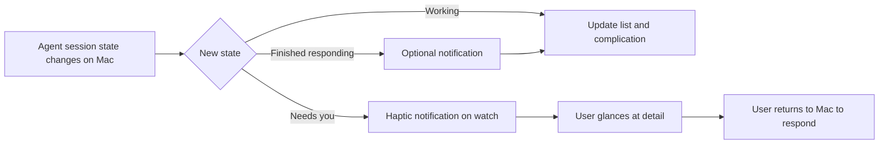

# AgenticWatch: Copilot Agent Status on Apple Watch

> **PRD-AGENTICWATCH-001** | Status: draft | Version: 0.1.0 | Last Updated: 2026-11-08

## Executive Summary

Developers increasingly hand long-running work to agent sessions in the GitHub Copilot app and then step away from the computer. Today they must return to the Mac to learn whether an agent is still working, is blocked waiting for them, or has finished. Blocked agents waste time, and repeated checking interrupts focus.

AgenticWatch brings agent status to the Apple Watch. At a glance, a developer can see which sessions are working, which need attention, and which have finished responding. The watch delivers a haptic notification when a session becomes blocked or finishes, so the developer can return only when it matters.

The first release is monitoring-only: it shows status and notifies. Answering questions, approving plans, or sending prompts from the watch is deferred to a later release (see DD-001). The primary success metric is a reduction in time agents spend blocked waiting for the user (GOAL-001).

Technical architecture, integration mechanism, and platform implementation details are intentionally out of scope for this document and will be captured in a separate technical design.

---

## Product Context

### Problem

* Agent sessions run for minutes to hours, often while the user is away from the desk.
* When an agent asks a question or needs plan approval, it stops until the user notices. There is no signal off the computer.
* Users compensate by repeatedly returning to the Mac to check, which breaks focus and still misses some blocked moments.

### Opportunity

* The GitHub Copilot app already distinguishes session states such as busy, idle, awaiting user input, and awaiting plan approval.
* The Apple Watch is always on the wrist, supports glanceable surfaces and haptics, and is well suited to short status checks.
* Comparable community projects and feature requests for other coding agents indicate real demand for wrist-level agent monitoring.

### Vision

"Know what your agents need without going back to your desk."

### Discovery findings

* No built-in Apple Watch support for GitHub Copilot app sessions was found.
* Status values available today do not distinguish "thinking" from "running a tool", and "idle" does not by itself mean the task succeeded. The product language must reflect this honestly (see DD-003).

---

## Users and Personas

### P1 — The Delegating Developer (primary)

* **Role:** Individual developer running one to several Copilot app agent sessions on a Mac.
* **Jobs-to-be-done:** "When I hand a task to an agent and step away, I want to know when it needs me or is done, so I can unblock it quickly and avoid needless checking."
* **Pain points:** Agents sit blocked unnoticed; frequent context switches to check status.
* **Success outcome:** Returns to the computer only when an agent needs input or has finished.

### P2 — The Multi-Session Orchestrator (secondary)

* **Role:** Power user running many parallel sessions across repositories, including coordinated child sessions.
* **Jobs-to-be-done:** "I want a quick overview of which of my sessions are working, blocked, or done, so I can prioritize my attention."
* **Pain points:** Hard to track many sessions; important blocked sessions get lost.
* **Success outcome:** Can identify the next session that needs attention within seconds from the wrist.

---

## Design Decisions

* **DD-001 — Monitoring-only MVP.** Release 1 shows status and notifies; it does not answer questions, approve plans, stop sessions, or send prompts. Rationale: delivers the core value with lower risk; acting on agents from a watch raises safety and authorization questions that need separate design.
* **DD-002 — Personal, single-user scope.** Release 1 covers one user's own sessions on their own Mac(s). Team or shared monitoring is out of scope.
* **DD-003 — Honest status language.** User-facing states are "Working", "Needs you", "Finished responding", and "Unknown/Offline". The product must not claim a task "succeeded" or that the agent is specifically "thinking" unless that is actually known.
* **DD-004 — Notification-first experience.** Notifications for "Needs you" are the primary value; the watch app and complications are secondary glance surfaces.
* **DD-005 — Technical design deferred.** How status is obtained from the Copilot app and delivered to the watch is out of scope for this PRD and is tracked as an open dependency (ASM-001).

---

## Product Goals

```text
GOAL-001: Reduce the time agent sessions spend blocked waiting for the user.
Priority: MUST
KPI: Median time from "Needs you" to the user responding drops by at least 50% versus the user's pre-adoption baseline within 4 weeks of adoption.
```

```text
GOAL-002: Reduce unnecessary trips back to the computer to check agent status.
Priority: SHOULD
KPI: At least 70% of surveyed users report fewer "just checking" trips after 2 weeks of use.
```

```text
GOAL-003: Make status trustworthy and glanceable.
Priority: MUST
KPI: At least 90% of "Needs you" and "Finished responding" notifications are reported as accurate and timely by users during beta.
```

**SMART Evaluation:** deferred to Validate. Baseline measurement approach for GOAL-001 is an open question (Q-002).

**Status**: deferred

---

## Functional Requirements

### Status viewing

* **FR-001: Session list on watch.** The watch shows a list of the user's active agent sessions with name, project, and current status.
  * Actor: P1, P2. Trigger: User opens the app. Outcome: List of sessions with statuses.
  * Acceptance: AC-001. Goals: GOAL-002, GOAL-003.
* **FR-002: Status states.** Each session displays exactly one state: Working, Needs you, Finished responding, or Unknown/Offline.
  * Actor: P1, P2. Trigger: Status shown anywhere. Outcome: Consistent state labels and visual treatment.
  * Acceptance: AC-002. Goals: GOAL-003.
* **FR-003: Attention-first ordering.** The session list orders "Needs you" sessions first, then Working, then Finished responding, then Unknown.
  * Actor: P2. Trigger: List displayed. Outcome: Sessions needing action appear at the top.
  * Acceptance: AC-003. Goals: GOAL-001.
* **FR-004: Session detail.** Selecting a session shows its state, how long it has been in that state, and, when it needs the user, a short summary of what it is waiting on (for example, "Question" or "Plan approval").
  * Actor: P1. Trigger: User taps a session. Outcome: Detail view.
  * Acceptance: AC-004. Goals: GOAL-001, GOAL-002.
* **FR-005: Freshness indicator.** Every status view shows when status was last updated.
  * Actor: P1, P2. Trigger: Any status view. Outcome: Visible "updated" time.
  * Acceptance: AC-005. Goals: GOAL-003.

### Notifications

* **FR-006: Needs-you notification.** When a session changes to "Needs you", the user receives a watch notification with a haptic, the session name, and the kind of attention needed.
  * Actor: P1, P2. Trigger: State change to Needs you. Outcome: Notification delivered.
  * Acceptance: AC-006. Goals: GOAL-001.
* **FR-007: Finished notification.** When a session changes from Working to Finished responding, the user receives a notification.
  * Actor: P1. Trigger: State change. Outcome: Notification delivered.
  * Acceptance: AC-007. Goals: GOAL-002.
* **FR-008: Notification preferences.** The user can turn each notification type on or off and choose to notify for all sessions or only selected sessions.
  * Actor: P1, P2. Trigger: User edits settings. Outcome: Preferences applied to future notifications.
  * Acceptance: AC-008. Goals: GOAL-002.
* **FR-009: No duplicate alerts.** The user receives at most one notification per state change per session.
  * Actor: P1, P2. Trigger: State change. Outcome: Single notification.
  * Acceptance: AC-009. Goals: GOAL-003.

### Glance surfaces

* **FR-010: Complication.** A watch-face complication shows the count of sessions needing the user and whether any are working.
  * Actor: P1, P2. Trigger: User glances at watch face. Outcome: Summary visible.
  * Acceptance: AC-010. Goals: GOAL-002.

### Setup and connection

* **FR-011: Pairing.** The user can connect AgenticWatch to their Copilot app on their Mac through a guided setup with no manual configuration files.
  * Actor: P1. Trigger: First run. Outcome: Watch shows sessions from that Mac.
  * Acceptance: AC-011. Goals: GOAL-003.
* **FR-012: Disconnected state.** When status cannot be refreshed, the app clearly shows that it is offline or stale rather than showing outdated status as current.
  * Actor: P1, P2. Trigger: Loss of connection. Outcome: Unknown/Offline state shown.
  * Acceptance: AC-012. Goals: GOAL-003.
* **FR-013: Disconnect and revoke.** The user can disconnect a Mac and stop all status sharing at any time.
  * Actor: P1. Trigger: User chooses disconnect. Outcome: No further status is shared.
  * Acceptance: AC-013. Goals: GOAL-003.

---

## Non-Functional Requirements

### Performance and Capacity

* **NFR-001:** "Needs you" notifications arrive on the watch within 30 seconds of the state change for at least 95% of events while the watch is connected.
* **NFR-002:** The session list opens and is readable within 2 seconds.

### Reliability and Resilience

* **NFR-003:** Status shown as current is never older than 2 minutes; older status is visibly marked stale.
* **NFR-004:** After temporary connection loss, status and pending attention states recover without user action.

### Security

* **NFR-005:** Only devices the user has explicitly paired can receive status.
* **NFR-006:** Status data is protected in transit and at rest on companion devices.

### Privacy

* **NFR-007:** Release 1 shares only the minimum needed: session name, project name, state, state duration, and attention type. Prompts, responses, code, and file contents are never sent to the watch.
* **NFR-008:** Notifications on a locked watch do not reveal more than the session name and state.

### Scalability and Elasticity

* **NFR-009:** Supports at least 25 concurrent sessions per user without degrading list readability or notification timeliness.

### Maintainability and Operability

* **NFR-010:** Changes in Copilot app status values degrade gracefully to Unknown rather than showing incorrect states.

### Observability

* **NFR-011:** Opt-in, privacy-preserving telemetry records notification delivery latency and user response time to measure GOAL-001 and NFR-001.

### Usability and Accessibility

* **NFR-012:** States are distinguishable without relying on color alone (icons and text).
* **NFR-013:** All screens support VoiceOver and Dynamic Type.
* **NFR-014:** A new user completes setup in under 3 minutes.

### Compatibility and Interoperability

* **NFR-015:** Works with the GitHub Copilot app on macOS; supported OS versions to be set in technical design.

### Portability

* **NFR-016:** Release 1 targets Apple Watch with an iPhone companion. Standalone watch and other wearables are out of scope.

---

## Constraints

* **CON-001:** Status is limited to what the GitHub Copilot app exposes. Source: fixed external system. Impact: states such as "thinking" versus "running a tool" cannot be promised.
* **CON-002:** watchOS limits background refresh and complication update frequency. Source: platform standard. Impact: complications cannot be real-time; notifications carry time-critical changes.
* **CON-003:** Distribution must follow Apple App Store review policies. Source: platform governance. Impact: affects release timeline and permissible behaviors.
* **CON-004:** No unsupported or terms-violating access to GitHub Copilot app internals may be used. Source: GitHub terms and governance. Impact: integration approach requires a supported mechanism (ASM-001).

---

## Process Models



---

## Acceptance Criteria

* **AC-001:** Given a paired Mac with 3 active sessions, When the user opens the app, Then all 3 sessions appear with name, project, and status. Covers FR-001.
* **AC-002:** Given any session, When its status is displayed, Then exactly one of Working, Needs you, Finished responding, or Unknown/Offline is shown. Covers FR-002.
* **AC-003:** Given sessions in mixed states, When the list displays, Then all "Needs you" sessions appear above all other states. Covers FR-003.
* **AC-004:** Given a session awaiting plan approval, When the user opens its detail, Then the view shows "Needs you", time in state, and "Plan approval". Covers FR-004.
* **AC-005:** Given any status view, When it is displayed, Then the last-updated time is visible. Covers FR-005.
* **AC-006:** Given Needs-you notifications are enabled, When a session changes to "Needs you", Then the user receives a haptic notification naming the session and attention type. Covers FR-006.
* **AC-007:** Given Finished notifications are enabled, When a session changes from Working to Finished responding, Then the user receives a notification. Covers FR-007.
* **AC-008:** Given the user disables Finished notifications, When a session finishes, Then no Finished notification is delivered. Covers FR-008.
* **AC-009:** Given a single state change, When notifications are delivered, Then the user receives exactly one notification for it. Covers FR-009.
* **AC-010:** Given 2 sessions need the user, When the user views a watch face with the complication, Then it shows a count of 2 within the platform's update limits. Covers FR-010.
* **AC-011:** Given a new user with the Copilot app installed, When they follow guided setup, Then the watch displays their sessions without editing configuration files. Covers FR-011.
* **AC-012:** Given status has not refreshed for more than 2 minutes, When the user views the app, Then sessions show Unknown/Offline or a clear stale indicator. Covers FR-012.
* **AC-013:** Given a paired Mac, When the user disconnects it, Then no further status or notifications from that Mac reach the watch. Covers FR-013.

All acceptance criteria status: Not Started.

---

## Traceability Matrix

### FR-to-AC Coverage

| FR | AC |
|---|---|
| FR-001 | AC-001 |
| FR-002 | AC-002 |
| FR-003 | AC-003 |
| FR-004 | AC-004 |
| FR-005 | AC-005 |
| FR-006 | AC-006 |
| FR-007 | AC-007 |
| FR-008 | AC-008 |
| FR-009 | AC-009 |
| FR-010 | AC-010 |
| FR-011 | AC-011 |
| FR-012 | AC-012 |
| FR-013 | AC-013 |

Coverage: 13/13 = 100.0% (threshold 80.0%).

### FR-to-GOAL Alignment

| FR | GOAL |
|---|---|
| FR-001 | GOAL-002, GOAL-003 |
| FR-002 | GOAL-003 |
| FR-003 | GOAL-001 |
| FR-004 | GOAL-001, GOAL-002 |
| FR-005 | GOAL-003 |
| FR-006 | GOAL-001 |
| FR-007 | GOAL-002 |
| FR-008 | GOAL-002 |
| FR-009 | GOAL-003 |
| FR-010 | GOAL-002 |
| FR-011 | GOAL-003 |
| FR-012 | GOAL-003 |
| FR-013 | GOAL-003 |

Coverage: 13/13 = 100.0% (target 100.0%).

---

## MVP and Release Framing

| Release | Scope | Rationale |
|---|---|---|
| **R1 — Monitor (MVP)** | FR-001 to FR-013 | Validates the core value: knowing when agents need you. |
| **R2 — Respond** | Quick replies to questions, approve/reject plans, stop a session, dictate a short prompt | Highest-value follow-up; requires safety and confirmation design. |
| **R3 — Expand** | Multiple Macs and cloud sessions, iPhone Live Activities, richer progress (for example, current step), team visibility | Broadens reach once the core experience is proven. |

**Non-goals for R1:** acting on sessions from the watch, viewing conversation content or diffs, starting new sessions, Android/Wear OS, and team dashboards.

---

## Success Metrics

| Metric | Definition | Baseline | Target | Window / Source | Goal |
|---|---|---|---|---|---|
| Time-to-respond | Median time from Needs you to user action | Measured in first week pre-enable (Q-002) | −50% | 4 weeks, opt-in telemetry | GOAL-001 |
| Check trips | Self-reported "just checking" trips to the Mac | Beta entry survey | 70% report fewer | 2 weeks, survey | GOAL-002 |
| Notification accuracy | Notifications rated accurate and timely | N/A | ≥ 90% | Beta, in-app feedback | GOAL-003 |
| Notification latency | p95 state change to watch delivery | N/A | ≤ 30 s | Beta, telemetry | GOAL-003 |
| Weekly active use | Users opening the app or receiving notifications weekly | N/A | ≥ 60% of installers | 4 weeks, telemetry | GOAL-002 |

---

## Risks and Assumptions

### Key Assumptions

| ID | Assumption | Evidence status | Impact if false | Mitigation | Source |
|---|---|---|---|---|---|
| ASM-001 | A supported way exists to read Copilot app session status from outside the app | Untested | Product cannot ship as designed | Validate first in technical spike; engage GitHub if needed | Discovery |
| ASM-002 | Current states (busy, idle, awaiting input, awaiting approval) are sufficient for useful monitoring | Partially supported | Value reduced | Gather beta feedback on missing states | Discovery |
| ASM-003 | Users want a watch, not just phone or desktop notifications | Partially supported | Low adoption | Validate with a small beta | Community requests |
| ASM-004 | Users accept installing an iPhone companion | Untested | Setup friction | Keep setup under 3 minutes | Assumption |

### Risk Register

| Risk | Probability | Impact | Mitigation |
|---|---|---|---|
| No supported status integration exists (ASM-001) | Medium | High | Prove integration before UI work |
| Copilot app changes status behavior | Medium | Medium | Graceful Unknown fallback (NFR-010) |
| Notification fatigue from many sessions | Medium | Medium | Per-session and per-type controls (FR-008) |
| Users misread "Finished responding" as "task succeeded" | Medium | Medium | Clear language (DD-003) |
| Status reveals sensitive project names on the watch | Low | Medium | Minimal data and lock-screen limits (NFR-007, NFR-008) |

### Open Questions

* **Q-001:** Should "Finished responding" notifications be on by default?
* **Q-002:** How do we measure the pre-adoption baseline for time-to-respond?
* **Q-003:** Should R1 include sessions from more than one Mac?
* **Q-004:** Is this a personal tool, an open-source project, or an App Store product? This affects distribution and support.

---

## Glossary

| Term | Definition |
|---|---|
| Agent session | A GitHub Copilot app conversation or project session where an agent performs work. |
| Needs you | The session is blocked waiting for a user answer or plan approval. |
| Working | The session is actively processing; it may be reasoning or running tools. |
| Finished responding | The session has returned to idle; this does not guarantee the task succeeded. |
| Complication | A small status element shown on an Apple Watch face. |

---

## Sign-Off

### Approval Checklist

* Product Sponsor: TBD
* Product Owner: @guybartal
* Technical Lead: TBD
* Quality Lead: TBD
* Legal/Compliance: TBD, required if distributed publicly

Approval date: Pending

### Waivers

None.

### Handoff Readiness

Not ready. Pending resolution of ASM-001 and open questions Q-001 to Q-004, followed by a technical design.
